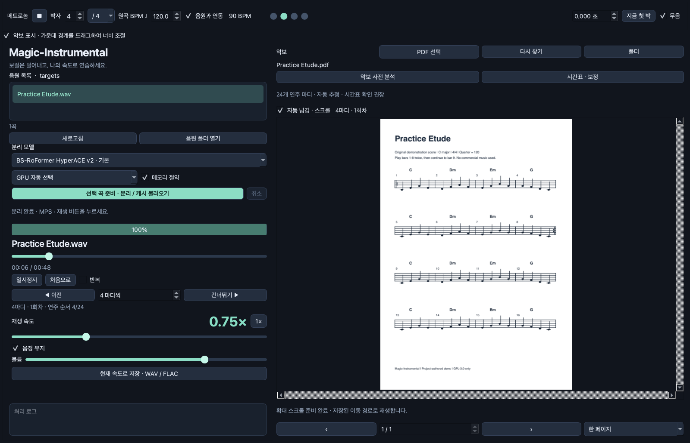
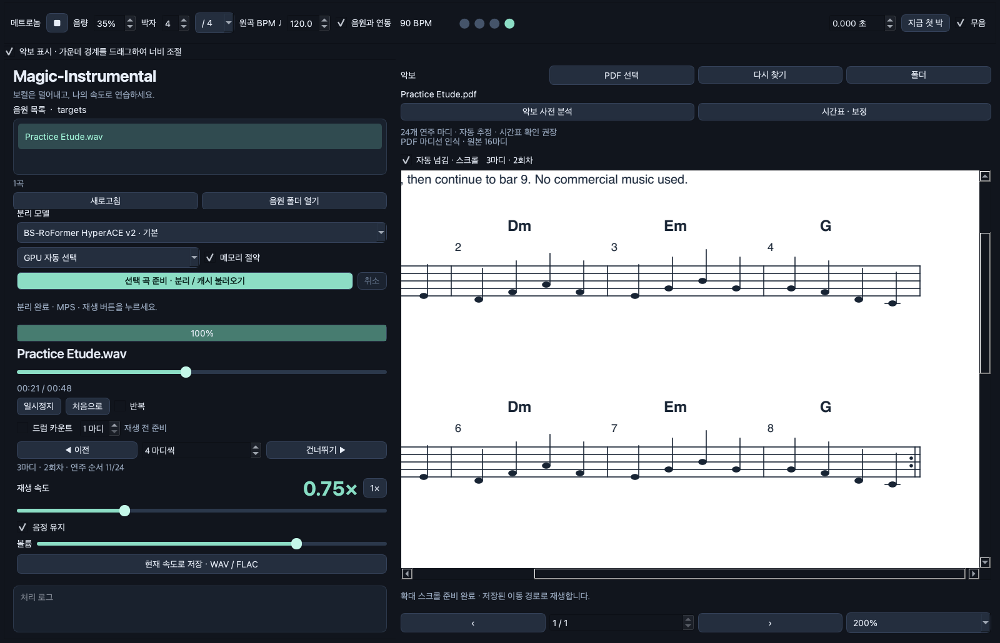

# Magic-Instrumental

A local Python desktop practice player for macOS and Windows: remove vocals, play the instrumental at 0.25–2× speed with pitch preservation, follow a pre-analyzed PDF score, and practice with a synchronized metronome. The application UI is currently in Korean.

[한국어 / full guide](README.md) · [User guide](docs/USER_GUIDE.md) · [Changelog](CHANGELOG.md) · [Contributing](CONTRIBUTING.md)

## Screenshots

Captured from the running Qt application with project-authored synthetic demo audio and a demo score. No personal or commercial recording or sheet music is shown.

## Install and run

Download **Magic-Instrumental-version.zip** from the [latest release](https://github.com/jeongwoo-gobroad/Magic-Instrumental/releases/latest), fully extract it, then double-click:

| Platform | Install / update | Launch |
|---|---|---|
| Apple Silicon, macOS 14+ | `install.command` | `start.command` |
| Windows 10/11 x64 | `install.bat` | `start.bat` |

No preinstalled Python is required. The installer downloads checksum-pinned uv, managed Python 3.12.14, and pinned dependencies into a user-owned external virtual environment. It does not install global Python packages or change the system PATH. An internet connection and several GB of free space are needed for installation. Model weights download on first use.

**Version 1.3.0 also installs Audiveris 5.11.0, its bundled Java runtime, and English OCR data automatically.** No separate Java install, language setup, command entry or administrator privileges are needed. Official downloads are SHA-256 checked; installation finishes only after Audiveris recognizes English words from a synthetic score. Rerun the same installer to verify/repair damaged files. Launching the app does not repeat downloads or OCR checks. OS security may still ask you to approve opening a downloaded file.

Native tools live under `~/.vocal-separator-and-speed-adj/tools/` on macOS or `%LOCALAPPDATA%\Magic-Instrumental\tools\` on Windows, independent of a custom Windows venv path. Existing system/manual Audiveris installations and reviewed score timelines are preserved.

On macOS, the environment is `~/.vocal-separator-and-speed-adj/.venv` (the folder name is retained for upgrade compatibility). If macOS blocks opening a downloaded command, verify the download source and follow the per-file Open / Privacy & Security prompt. If executable permissions are missing, run `zsh install.command` and `zsh start.command` in Terminal.

On Windows, the installer creates `venv-location.windows.txt` from its example. To choose a different location before installation, copy `venv-location.windows.example.txt` to that name and enter one absolute path outside this project. Default: `%LOCALAPPDATA%\Magic-Instrumental\.venv`. Use `install.bat -Cpu` or `install.bat -Cuda` to override automatic NVIDIA detection. Drivers are installed separately. Intel Macs and Windows ARM are not supported by this release.

## Version 1.6.0: mixed notation and native Guitar Pro input

For consistently paired five-line notation and six-line TAB, analysis masks the TAB region in a private native-resolution copy, recognizes standard notation with Audiveris, and maps measures against both staves in the unchanged PDF. The full original remains visible. Dense fret-number gaps and long ledger lines are handled more reliably; progress shows page, recognition stage and elapsed time.

Select **MusicXML / GP 선택** and a **GP 악기 트랙** (track number) to read GP3/4/5 directly, or place one matching-name source next to the PDF. The installer includes [PyGuitarPro 0.11](https://github.com/Perlence/PyGuitarPro), **LGPL-3.0-only**; see [third-party notices](THIRD_PARTY_NOTICES.md). Native import bypasses OMR and reads notes, meter, repeats and supported navigation. PDF geometry still supplies the camera positions.

Use the same edition, measure order and instrument track. Mismatched measure counts stop analysis rather than shifting or padding the score. Matching counts alone do not prove identical arrangements. Mixed PDF recognition must also pass layout validation. TAB-only fret recognition, GPX/GP7, percussion tracks and double-segno/double-coda navigation are unsupported; performance effects and estimated audio alignment need review.

Rerun the installer, restart the app, and clear “reuse existing timing” when reanalyzing a failed score. New recognition caches exclude legacy OMR results while preserving originals and reviewed timelines. Underfilled non-pickup measures retain their meter length with a warning about missing notation.

## Practice

**v1.5.0: measure-range practice loops.** Prepare the audio and analyze the score, choose **시작 / 끝** (start/end measures), enable **마디 구간 반복**, then press Play. The final selected measure is included. Repeated measures are distinguished by visit number and performance order; **현재 마디** selects the current measure. The checkbox pauses and moves to the range start without starting playback.

Enable **매회 드럼 카운트** for a count before the first entry and every repeat. It uses the existing 1–4-bar count length, original BPM, meter, downbeat origin, playback speed and metronome volume/mute. This option is independent of the manual play/resume count checkbox. With it off, repeats return immediately, while the first manual start still follows the normal count setting.

Range looping and **곡 전체 반복** (whole-track looping) are mutually exclusive. Seeks stay inside the active range. Changing the selected range or score timing disables looping and pauses; re-enable it after review. Saved selections are restored only for matching audio and timing, never automatically enabled. Review estimated measure times before practice. Timer and device latency can affect the boundary; this is not sample-accurate, gapless looping. [Range-loop screenshot](docs/images/measure-loop.png)

**v1.4.0: optional drum count-in.** Enable **드럼 카운트** below the play button and select **1–4 bars**. The count uses the top bar's original quarter-note BPM, meter, first-downbeat offset and current playback rate; then music starts from its existing position. At 120 BPM, 4/4 and one bar, this takes 2 seconds at 1× or 4 seconds at 0.5×. The mode defaults off and is remembered across app restarts.

Count-in works independently of the audio-sync checkbox and shares metronome volume/mute. Normal metronome clicks are held during the drum count; beat circles show progress. Mid-beat entries preserve the track's beat numbering and shorten the final interval to match the requested position. Press the play button again to cancel. Seeking, track/tempo/meter/speed changes, disabling the mode, or starting processing also cancel pending playback. Manual resume counts again; ongoing playback seeks and whole-track loops do not insert a count. Range loops follow their separate per-repeat option. Device-dependent playback latency remains; this is not sample-accurate recording synchronization. [Count-in screenshot](docs/images/drum-count-in.png)

Put your audio in `targets/`. Refresh, select it, prepare the track, then play. Instrumentals are cached by the complete file SHA-256 and processing settings; changing a filename does not require separation again. Common FFmpeg audio formats are supported; DRM-protected downloads are not.

Put a matching PDF in `score_targets/`, for example `Practice Song.mp3` and `Practice Song.pdf`. Resize the right-hand score panel and choose the zoom **before** analyzing. Repeat signs, endings, D.C./D.S./coda navigation, audio alignment, and scrolling paths are computed ahead of playback. Adjustable measure skips follow performance order, including repeat visits.

PDF viewing and preparation of [Audiveris](https://audiveris.github.io/audiveris/_pages/tutorials/install/binaries/) plus English OCR data (`eng`) are included in the installer. A matching MusicXML file can replace recognition. Recognition and alignment are estimates requiring review; they are not guaranteed automatic transcription.

Version **1.1.0** detects actual PDF staves and barlines without requiring MusicXML line breaks or measure widths. It handles portrait/landscape and mixed paper sizes, short final systems, five/six-line staves, and mildly skewed scans. Positioned PDF navigation text and repeat-dot pairs can supplement missing OMR marks. Six-line layout detection does not imply automatic tablature pitch recognition. Measure counts and staff configurations must agree with the notation; uncertain layouts use validated XML print metadata or request correction.

After updating, rerun the installer and score analysis. Keep “reuse existing timing” selected to preserve reviewed timing while updating camera paths; clear it to rerun symbol analysis. Source PDFs and MusicXML are never rewritten.

In **v1.2.0**, checking audio synchronization arms the metronome to follow playback automatically, using the original BPM multiplied by playback speed, beat circles, meter, and a first-downbeat offset. Slider, measure, timeline and restart seeks, plus track loops, re-establish the beat at the destination. Mid-beat seeks wait for the next boundary. Pause/resume and small clock corrections do not duplicate a click. The metronome button can disable clicks independently. Version **1.2.1** adds a separate **0–100% click volume** control (default 35%), remembered across songs and app restarts. Mute preserves the selected level; gain changes do not restart the beat clock. This uses a constant entered tempo, not automatic tempo tracking or sample-accurate audio mixing.

Live pitch preservation uses Qt's QMediaPlayer pitch compensation, implemented with [Signalsmith Stretch](https://doc.qt.io/qt-6/qtmultimedia-attribution-signalsmith-stretch.html) in the default FFmpeg backend. WAV/FLAC exports use FFmpeg's WSOLA-based `atempo`; 0.25× chains two 0.5× filters. These are different processors, so live and exported audio need not be identical. Independent semitone transposition is not implemented.

## Audiveris attribution

We use **[Audiveris](https://github.com/Audiveris/audiveris)** for PDF music recognition and MusicXML export, and acknowledge its developers and contributors. The app invokes the separately installed, unmodified Java program through its CLI; no Audiveris source or binary is bundled here. Supplying matching MusicXML bypasses OMR.

Automated installation is not itself prohibited by these licenses. The installer downloads official upstream distributions directly to the user's computer, preserves their bundled notices, and saves the Audiveris AGPL and tessdata Apache-2.0 texts plus pinned source links under `licenses/` and `sources.json`. This repository ships source installer code, not repackaged native binaries. Distributing binaries, modified versions or a hosted service requires its own assessment of the applicable source and notice obligations; this arrangement is not a blanket exemption.

Audiveris is **AGPL-3.0-or-later**, as confirmed by its [license](https://github.com/Audiveris/audiveris/blob/master/LICENSE) and [source header](https://github.com/Audiveris/audiveris/blob/master/app/src/main/java/org/audiveris/omr/Main.java). Its own notice, source-disclosure and applicable network-use terms must be followed when modifying, redistributing or providing it as a service. This project's GPL notice does not relicense Audiveris.

## Media, privacy and licensing

**No recordings or scores are included. Users must obtain and supply their own legally authorized audio and sheet music, paying the required price where applicable.** Freely distributed works must also be used under their terms. Purchasing a copy does not automatically grant redistribution rights. Do not share copyrighted originals or derived stems without permission.

The application processes media locally. Dependency and model downloads contact their distributors; audio and scores are not uploaded by this app. Media, caches, model weights, and personal path settings are excluded from source releases. Any cloud-folder synchronization is controlled by the user's storage provider.

Original project code and documentation are **GPL-3.0-only**; see [LICENSE](LICENSE). **Models and dependencies retain their own licenses**, and GPL does not license your recordings or scores. The default HyperACE v2 model has no explicit weight license in the checked author card; do not assume commercial or redistribution permission. The alternative Mel-Band RoFormer deux weights are CC BY-NC 4.0. See [third-party notices](THIRD_PARTY_NOTICES.md).

Apple Silicon installation and actual MPS inference have been exercised. Windows hardware audio and NVIDIA inference still need validation. Automated tests use synthetic media; this project makes no universal separation-quality or score-recognition guarantees.
