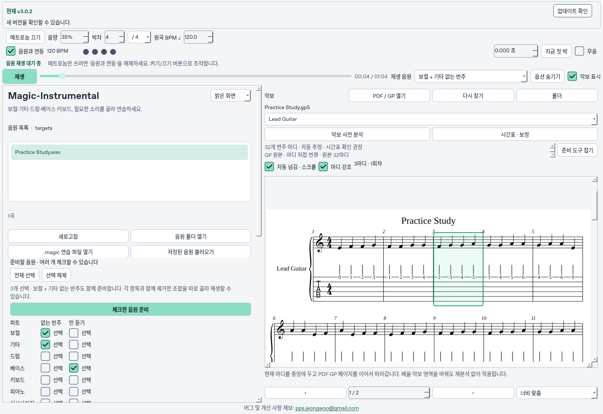

# Magic-Instrumental

Make an instrumental on your computer, choose a score or Guitar Pro part, then practise at your own pace. A Python desktop app for Apple Silicon macOS and Windows, with a separate offline tablet player for iPad and Android.

[한국어 / full beginner guide](README.md) · [Tablet guide](web_player/README.md) · [Changelog](CHANGELOG.md) · [Developer guide](CONTRIBUTING.md)

In a small window, scroll down the left side to reach the save buttons. Drag the divider to widen the score. Press **준비 도구 접기** in the score panel to hide the setup controls and make the page taller. Press the same button to bring them back. On a phone, open your .magic file first, then tap **재생 조절로** for playback controls or **악보로** for the score.

## Install and open

Download the latest **Magic-Instrumental-version.zip** from [Releases](https://github.com/jeongwoo-gobroad/Magic-Instrumental/releases/latest) and fully extract it. Double-click `install.command` on Mac or `install.bat` on Windows. Wait for completion. For everyday use, double-click `start.command` or `start.bat`.

The installer prepares Python, dependencies, FFmpeg, Audiveris, Java, English OCR data and GP engraving tools without a preinstalled Python or administrator access. All project packages live in an external virtual environment. An internet connection is needed for initial setup and model downloads. Supported desktop targets: macOS 14+ Apple Silicon and Windows 10/11 x64. The interface is Korean.

**If Windows freezes or closes while checking for updates:** close the app and error window, double-click the existing `update.bat`, then reopen with `start.bat`. Update to v2.3.1 or later; no in-app button is needed. Keep your audio, scores and processed results. Reinstallation is not required for this fix.

## Update without moving your songs

On Windows, the key controls become available as soon as the first instrumental is ready. Cancelling an analysis or separation also stops its helper processes. Completed instrumentals remain available on the next launch.

At startup, the desktop shows your current version and checks the latest stable release in the background. When available, use **변경 내용** (release notes) and **종료하고 업데이트** (close and update). The updater waits for the app to exit, then preserves your files and settings. Reopen with `start` after completion. Offline checks never block practice, and **다시 확인** retries. Finish any analysis/export before updating. Nothing installs automatically.

Close the app, then double-click **`update.command` (Mac)** or **`update.bat` (Windows)** in your existing app folder. Wait for completion and use the same `start` file. The updater checks required tools in your existing external environment automatically.

If your older version has no update file, download and fully extract the [small updater ZIP](https://github.com/jeongwoo-gobroad/Magic-Instrumental/releases/latest/download/Magic-Instrumental-Updater.zip). Double-click its update file and select your **existing app folder containing `start` and `targets`**. Future updates use the update file added to that original folder.

Recordings, scores, processed instrumentals, reviewed timings, models, `.magic` exports and personal settings stay in place. Do not delete the old folder. Internet is required. If interrupted, run the updater again to recover and retry. Developer Git checkouts are not updated by this tool. [Detailed steps (Korean)](docs/UPDATING.md)

## Your first practice session

1. Put a lawfully obtained recording into `targets/`.
2. Refresh the list, choose the song, and prepare its instrumental. Identical file contents reuse verified cached results.
3. Open a PDF or GP3/GP4/GP5 score. For GP, choose the instrument **by name**; no companion PDF is required.
4. Choose score zoom and panel width, run score pre-analysis, then review the timing.
5. Play at 0.25–2× speed, change the instrumental key by ±12 semitones, jump by measures or repeat a selected range. Optional drum counts and the independently adjustable metronome follow the original-media clock.
6. Save a `.magic` practice file and open it in the tablet player. New GP-derived files include every part's rendered pages and a shared timing reference, so mobile playback requires no score recognition or GP software.

Applied desktop key changes are included in the exported audio. The web player can add another ±12 semitones; the default is zero additional shift. Original printed notes/TAB are not transposed. Supported PDF layouts contain one part’s standard staff or TAB staff per measure. PDFs displaying standard notation and TAB together are not supported; neither are multi-instrument full scores or irregular layouts. Automatic pitch recognition from TAB numerals is not provided. PDF recognition and audio alignment can require manual correction. PNG/JPG/JPEG score images are not direct inputs. Image-only or scanned PDFs can fail recognition because of resolution, skew or blur. GPX and GP6/7/8 are currently unsupported. Drum parts use fixed-BPM timing.

**Desktop metronome alone:** uncheck ‘음원과 연동’ (link to audio), then press ‘메트로놈 켜기’ (turn metronome on). No song is required. An always-visible hint and status show standalone playback, waiting for audio, linked playback, or other waiting states; mute and zero volume are also indicated.

For iPad/Android, [open Magic Player](https://jeongwoo-gobroad.github.io/Magic-Instrumental/) in Safari/Chrome and add it to the home screen. After offline preparation, it works without internet; songs remain local. Direct HTML opening on iPad's Files app is not reliable. Keep the player visible during practice; backgrounding pauses playback. Open the player online to receive an update. On your next visit, the footer shows the version in use. [Tablet instructions](web_player/README.md)

**To use the mobile metronome alone, uncheck ‘반주와 함께’ (with accompaniment), then turn it on.** No song file is required. With that box checked, clicks wait until the accompaniment plays; the header shows the waiting state.

## Session mode

Open the web player from the desktop's **Session 모드 · 함께 연습하기** button, or directly on PC/iPad/Android. The leader opens a `.magic`, enables leader mode and shares the eight-character invite code or QR. Members join, choose their own file or download the leader's explicitly shared all-part GP bundle, select their part, then press **합주 준비** (ready).

The interface changes to a leader control view or a member score view. Only the leader can play, pause and seek; commands are scheduled 1–5 seconds ahead using the relay clock. The leader changes speed/key/count/loop settings while paused. Each participant controls their score part, zoom, volume and metronome on/off. Leaving Session restores the solo interface.

Own files must derive from the identical original recording bytes and duration, though scores may differ. All analysis stays on the desktop and playback runs on each device. The relay handles room membership, clock/control messages and opt-in file transfer. Shared files expire when the room closes, after four hours or on server restart. Solo playback remains offline; Session needs internet and a visible foreground page. Device/Bluetooth output delay is not automatically calibrated. PC leadership uses the same web player as tablets; the native desktop player is paused when opening it.

**GP numbers appearing as black boxes on Windows:** update to v2.1.1 or later, reopen the GP file and run score pre-analysis. GP digits and labels are now stored as vector outlines. Export a new `.magic` to replace previously rendered pages. Original media, GP files and earlier reviewed timeline files are retained.

## Rights and attribution

**Recordings and scores are not supplied.** Obtain your own materials lawfully, paying applicable charges. Buying a recording or score does not grant permission to redistribute its original, separated instrumental or `.magic` bundle.

Original project code/docs: GPL-3.0-only. Models and dependencies retain their own licenses. PDF recognition uses Audiveris; GP parsing uses PyGuitarPro; engraving uses Verovio; mobile rate/pitch processing uses Signalsmith Stretch. See [third-party notices and model provenance](THIRD_PARTY_NOTICES.md). Screenshots contain only project-authored synthetic music.

Automated checks distinguish desktop installation, browser execution, and real hardware validation; see [developer documentation](CONTRIBUTING.md). No claim of universally best separation, perfect recognition, or testing on every physical device is made.

Desktop and web footers include a clickable bug and improvement report address. Opening the link composes an email; no files are attached automatically.
