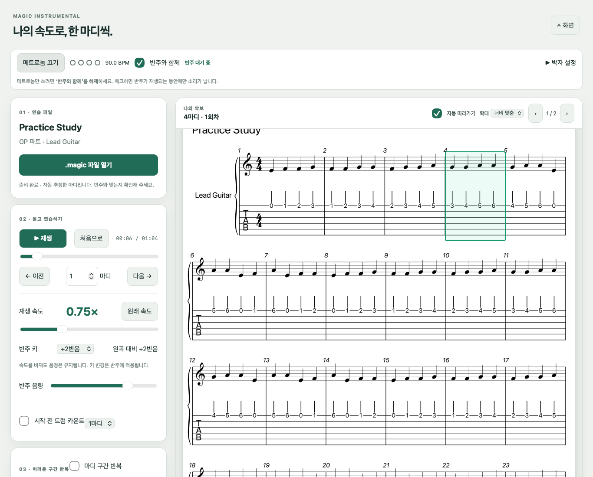

# Magic Player · iPad / Android 연습 재생기

**컴퓨터에서 준비한 반주와 악보를 태블릿에서 바로 연습하세요.**

음악을 분석하는 일은 컴퓨터의 [Magic-Instrumental](https://github.com/jeongwoo-gobroad/Magic-Instrumental)이 합니다. 이 재생기는 준비된 **`.magic` 파일**을 열어 반주와 악보를 보여 줍니다. **PDF에서 만든 파일과 GP3·GP4·GP5의 선택한 파트에서 만든 파일을 모두 지원합니다.**

## 1. 컴퓨터에서 준비하기

1. Magic-Instrumental에서 곡을 선택하고 **반주 준비**를 누릅니다.
2. **PDF / GP 열기**로 악보를 고릅니다. GP라면 원하는 **파트 이름**을 선택합니다.
3. **악보 사전 분석**을 실행하고, 마디가 음악과 맞는지 확인합니다.
4. **태블릿으로 가져가기 · .magic 저장**을 누릅니다.
5. 만들어진 `.magic` 파일을 AirDrop, USB 또는 평소 쓰는 파일 전송 방법으로 태블릿에 복사합니다.

반주·원본 악보·선택한 파트의 화면·마디 시간표가 하나의 파일에 담깁니다. 태블릿에 Python이나 Audiveris, Guitar Pro를 설치할 필요가 없습니다. 파트를 바꾸려면 컴퓨터에서 다른 파트를 선택한 뒤 새 파일로 저장하세요.

## 2. 재생기 열기

배포된 재생기 주소를 **iPad에서는 Safari**, **Android에서는 Chrome**으로 여세요. 이 저장소의 `mobile-player` 브랜치는 정적 웹 배포용입니다. 배포 주소가 아직 안내되지 않았다면 데스크톱 저장소의 README에서 게시 상태를 확인해 주세요.

- **iPad**: Safari의 공유 버튼 → **홈 화면에 추가** → 추가.
- **Android**: Chrome 메뉴 **⋮** → **홈 화면에 추가** 또는 **앱 설치**.

처음에는 인터넷이 필요합니다. 화면에 **오프라인 준비 완료**가 표시될 때까지 기다리세요. 이후에는 홈 화면의 아이콘으로 인터넷 없이도 열 수 있습니다. 브라우저의 사이트 데이터가 삭제되면 온라인으로 한 번 더 열어 주세요.

iPad의 ‘파일’ 앱에서 내려받은 HTML을 누르면 실행 대신 미리보기가 나올 수 있으므로 위 방식을 사용하세요. 컴퓨터에서는 `index.html`을 직접 열어 쓸 수도 있습니다. 브라우저가 소리 기능을 제한하면 웹주소 방식을 사용하세요.

## 3. 곡 열고 연습하기

1. **.magic 파일 열기**를 누릅니다.
2. 파일 선택 창에서 준비한 파일을 고릅니다.
3. **재생**을 누르고, 속도를 낮춰 연습해 보세요.

파일은 이 기기 안에서만 읽습니다. 녹음·악보를 서버로 전송하지 않습니다. 화면을 닫았다가 다시 열면 연습할 파일을 다시 선택하세요. 큰 곡은 처음 열 때 잠시 걸릴 수 있습니다.

| 하고 싶은 일 | 누를 곳 |
|---|---|
| 천천히 듣기 | **재생 속도**. 속도를 바꿔도 음정은 유지됩니다. |
| 반주 높낮이 바꾸기 | **반주 키**. 파일에 담긴 반주를 기준으로 추가 ±12반음입니다. 원곡 대비 변화량도 표시합니다. |
| 원하는 곳으로 이동 | 재생 막대 또는 **이전 / 다음**. 한 번에 이동할 마디 수를 정할 수 있습니다. |
| 어려운 구간 반복 | **시작·끝 마디** 선택 → **마디 구간 반복**. 끝 마디까지 포함합니다. |
| 박을 듣고 들어가기 | **시작 전 드럼 카운트**. 반복마다 듣고 싶으면 **반복할 때마다 드럼 카운트**도 켭니다. |
| 메트로놈 맞추기 | **박자 설정**에서 원곡 BPM·박자·첫 박을 정하고 **반주와 함께**를 켭니다. 단독 재생도 됩니다. |
| 크게 보기 | 악보 위쪽의 **확대**. **자동 따라가기**를 켜면 현재 마디를 따라 이동합니다. |
| 직접 악보 넘기기 | 악보를 손으로 움직이거나 **‹ / ›**. 다시 따라가려면 **자동 따라가기**를 켭니다. |
| 화면 바꾸기 | 오른쪽 위 **화면** 버튼. 가로·세로 회전도 가능합니다. |

컴퓨터에서 +2반음을 적용한 반주를 저장했다면, 처음 열 때 그대로 +2반음으로 들립니다. 모바일에서 추가 -1을 고르면 원곡보다 +1반음이 됩니다. **음표와 타브 숫자는 원본 그대로**입니다.

## 막히는 일이 있다면

- **파일이 목록에 없어요**: `.magic` 파일이 기기에 완전히 내려받아졌는지 확인하세요. PDF·MP3·GP 원본을 이 재생기에서 직접 분석하지는 않습니다.
- **소리가 안 나요**: 재생을 직접 누르고 기기·반주 음량을 확인하세요. 화면을 켜 둔 채 사용합니다. 다른 앱으로 이동하거나 화면을 잠그면 일시정지합니다. 유선·블루투스 장치의 지연은 달라질 수 있습니다.
- **마디가 안 맞아요**: 컴퓨터의 **시간표 · 보정**에서 수정하고 `.magic`을 다시 저장하세요. 원곡 BPM 입력은 메트로놈을 위한 것이며 저장된 마디 시간을 다시 분석하지 않습니다.
- **파일이 손상되었다고 해요**: 컴퓨터에서 새 이름으로 저장하고 다시 전송하세요. 일반 ZIP 도구로 재압축한 파일은 지원하지 않습니다.
- **큰 파일에서 멈춰요**: 다른 앱을 닫고 다시 열어 보세요. 파일 전체 1 GB, 반주 PCM 512 MB까지 검사하지만 실제 사용 한도는 기기 메모리에 따라 더 작습니다. 긴 곡은 나누어 준비하세요.

## 이용 안내

**음원·악보는 정당한 대가를 지불하는 등 적법한 권한을 확보하여 직접 준비해야 합니다.** 구매가 다른 사람에게 재배포할 권한을 의미하지는 않습니다. `.magic`에는 실제 반주와 원본 악보가 들어 있으므로 공유 전 이용 조건을 확인하세요.

자체 코드는 GPL-3.0-only, 배속·키 처리를 위한 Signalsmith Stretch는 MIT 라이선스입니다. [자세한 고지](https://github.com/jeongwoo-gobroad/Magic-Instrumental/blob/main/THIRD_PARTY_NOTICES.md). 모델 가중치는 포함하지 않습니다. [개발자 문서](https://github.com/jeongwoo-gobroad/Magic-Instrumental/blob/main/docs/MAGIC_FORMAT.md)

Chromium·WebKit의 실제 브라우저 테스트를 수행합니다. 물리 iPad·Android 기기 전체를 검증했다는 의미는 아닙니다. 화면 크기·오디오 출력·브라우저 버전에 따른 차이가 있을 수 있습니다.
