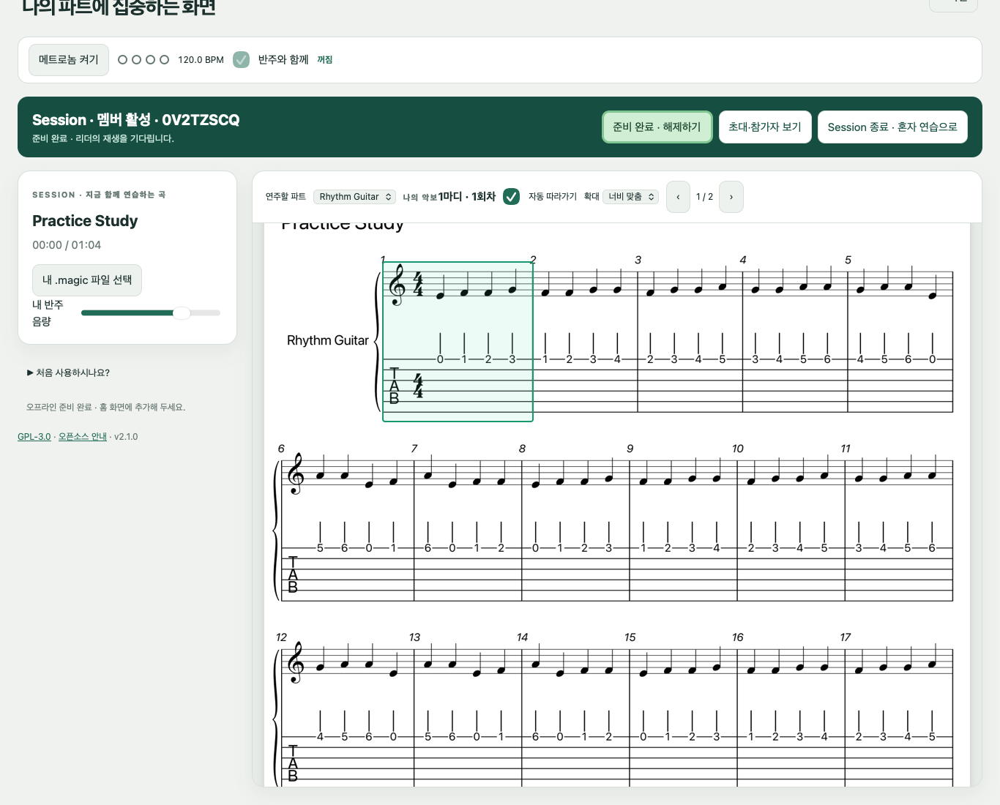

# Magic Player · iPad / Android 연습 재생기

**컴퓨터에서 준비한 반주와 악보를 태블릿에서 바로 연습하세요.**

현재 버전: **2.4.7**

음악을 분석하는 일은 컴퓨터의 [Magic-Instrumental](https://github.com/jeongwoo-gobroad/Magic-Instrumental)이 합니다. 이 재생기는 준비된 **`.magic` 파일**을 열어 반주와 악보를 보여 줍니다. **PDF에서 만든 파일과 GP3·GP4·GP5의 전체 파트를 담은 파일을 모두 지원합니다.**

.magic 파일을 고르면 파일을 읽는 상태가 표시됩니다. 열 수 없으면 파일 선택 버튼 아래에 이유가 표시됩니다. 다른 곡을 읽다가 실패하면 제목·재생 시간·악보가 비워집니다. **.magic 파일 열기**를 눌러 사용하던 파일이나 다시 복사한 파일을 선택하세요. 곡이 열린 뒤 소리 준비에 실패한 경우에는 곡을 유지하므로 **재생**을 다시 누르면 됩니다.

## 1. 컴퓨터에서 준비하기

1. Magic-Instrumental에서 곡을 선택하고 **반주 준비**를 누릅니다.
2. **PDF / GP 열기**로 악보를 고릅니다. 가능하면 **Guitar Pro 원본(`.gp3`, `.gp4`, `.gp5`)을 권장합니다.** 음표와 마디를 직접 읽을 수 있고, 원하는 파트를 이름으로 고를 수 있습니다.
3. **악보 사전 분석**을 실행하고, 마디가 음악과 맞는지 확인합니다.
4. **태블릿으로 가져가기 · .magic 저장**을 누르고 **연습 파일 반주 음질**에서 음질을 고릅니다. 기본은 **MP3 256 kbps · 권장**이며, MP3 128·192·320 kbps 또는 **WAV · 무손실**도 선택할 수 있습니다.
5. **저장 위치 선택…**을 눌러 이름과 위치를 정합니다. 확정한 음질은 다음 저장에도 기억합니다.
6. 만들어진 `.magic` 파일을 AirDrop, USB 또는 평소 쓰는 파일 전송 방법으로 태블릿에 복사합니다.

반주·원본 악보·전체 GP 파트의 화면·마디 시간표가 하나의 파일에 담깁니다. 태블릿에 Python이나 Audiveris, Guitar Pro를 설치할 필요가 없습니다. 새로 저장한 GP 파일은 악보 위 **연주할 파트**에서 바꿀 수 있습니다. 재생 중에도 반주는 끊기지 않습니다. 예전에 저장한 단일 파트 파일은 그대로 열리며, 전체 파트가 필요하면 PC에서 한 번 다시 저장하세요.

MP3는 파일에 담는 반주 크기를 줄입니다. 전체 파일의 감소 폭은 악보 크기에 따라 다르며, 재생할 때 반주를 풀어 쓰기 때문에 메모리 사용량까지 같은 비율로 줄지는 않습니다. 기존 WAV 반주의 `.magic`도 계속 열립니다. 기존 파일은 자동 변환되지 않고, PC에서 새로 저장할 때 선택한 음질이 적용됩니다.

컴퓨터에서 자동 대체 분석으로 마디선과 BPM 시간표를 준비한 PDF도 가져올 수 있습니다. 단일 보표부터 총보까지 원본 화면을 유지하며 PDF 파트를 따로 나누지 않습니다. 같은 총보 줄에서는 세로 위치를 유지하므로 모든 악기가 보이도록 배율을 정하세요. 반복·변박·템포 변화는 컴퓨터에서 연주 순서와 시간표를 확인한 뒤 저장합니다.

## 2. 재생기 열기

**[▶ Magic Player 열기](https://jeongwoo-gobroad.github.io/Magic-Instrumental/)**

작은 화면에서는 **.magic 파일 열기**가 악보보다 먼저 나옵니다. 곡을 연 뒤에는 화면 위의 **재생 조절로**와 **악보로**를 눌러 이동하세요.

위 주소를 **iPad에서는 Safari 또는 Chrome**, **Android에서는 Chrome**으로 여세요. 브라우저에서 주소를 연 뒤 화면의 **.magic 파일 열기**를 누릅니다. 홈 화면에 추가하려면 아래 순서를 사용하세요.

- **iPad**: Safari의 공유 버튼 → **홈 화면에 추가** → 추가.
- **Android**: Chrome 메뉴 **⋮** → **홈 화면에 추가** 또는 **앱 설치**.

처음에는 인터넷이 필요합니다. 화면에 **오프라인 준비 완료**가 표시될 때까지 기다리세요. 이후에는 홈 화면의 아이콘으로 인터넷 없이도 열 수 있습니다. 새 버전을 받으려면 인터넷에 연결해 재생기를 여세요. 다음에 열 때 화면 맨 아래에서 버전을 확인할 수 있습니다. 브라우저의 사이트 데이터가 삭제되면 온라인으로 한 번 더 열어 주세요.

iPad의 ‘파일’ 앱에서 내려받은 HTML을 누르면 실행 대신 미리보기가 나올 수 있으므로 위 방식을 사용하세요. 컴퓨터에서는 `index.html`을 직접 열어 쓸 수도 있습니다. 브라우저가 소리 기능을 제한하면 웹주소 방식을 사용하세요.

## 3. 곡 열고 연습하기

1. **.magic 파일 열기**를 누릅니다.
2. 파일 선택 창에서 컴퓨터에서 저장한 `.magic` 파일을 고릅니다. 다른 종류의 파일도 목록에 보일 수 있습니다.
3. 읽기가 끝나 곡 제목·전체 시간·악보가 나타나면 **재생**을 누르고, 속도를 낮춰 연습해 보세요.

**iPad에서 파일이 회색으로 표시되어 선택하지 못했다면:** 인터넷에 연결해 재생기를 새로고침하거나 탭을 다시 여세요. Safari와 Chrome 모두 재생기 안의 **.magic 파일 열기**에서 선택합니다. 파일 이름을 바꾸거나 컴퓨터에서 다시 저장할 필요는 없습니다. 파일을 열 때 내용도 확인하므로 다른 파일이나 손상된 파일을 고르면 오류가 표시됩니다.

**Chrome이나 홈 화면 앱에서 파일 열기가 멈췄다면:** 인터넷에 연결해 재생기를 새로고침하거나 완전히 닫았다가 다시 열고, 화면 맨 아래에 **2.4.7 이상**이 표시되는지 확인하세요. 이 버전은 파일을 먼저 읽어 악보를 표시하고, 소리는 **재생** 또는 Session의 **합주 준비**를 직접 누를 때 준비합니다. 소리 준비 오류가 나면 화면을 켜 둔 채 해당 버튼을 다시 누르세요. 기존 `.magic` 파일을 다시 내보낼 필요는 없습니다.

**곡과 악보는 열리는데 iPad에서 소리가 나지 않았다면:** **2.4.7 이상**으로 갱신한 뒤 **재생**을 직접 누르세요. 지원하는 브라우저에서는 재생·메트로놈 켜기·합주 준비를 누를 때 음악 재생용 소리 설정을 요청합니다. 2.4.6의 파일 읽기 개선은 그대로 유지하며, 기존 파일을 다시 저장할 필요가 없습니다. 소리 준비 오류가 나면 파일을 다시 열지 않고 **재생** 또는 **합주 준비**를 다시 누르세요. 선택한 파트·재생 위치·속도·키·반복 설정은 유지합니다. 다른 앱에서 돌아오는 것만으로는 재생이 다시 시작되지 않습니다.

혼자 연습할 때는 파일을 이 기기 안에서만 읽습니다. Session 모드에서도 리더가 **파일 공유**를 누른 경우에만 그 파일을 서버로 전송합니다. 화면을 닫았다가 다시 열면 연습할 파일을 다시 선택하세요. 큰 곡은 처음 열 때 잠시 걸릴 수 있습니다.

| 하고 싶은 일 | 누를 곳 |
|---|---|
| 천천히 듣기 | **재생 속도**. 속도를 바꿔도 음정은 유지됩니다. |
| 반주 높낮이 바꾸기 | **반주 키**. 파일에 담긴 반주를 기준으로 추가 ±12반음입니다. 원곡 대비 변화량도 표시합니다. |
| 원하는 곳으로 이동 | 재생 막대 또는 **이전 / 다음**. 한 번에 이동할 마디 수를 정할 수 있습니다. |
| 어려운 구간 반복 | **시작·끝 마디** 선택 → **마디 구간 반복**. 끝 마디까지 포함합니다. |
| 박을 듣고 들어가기 | **시작 전 드럼 카운트**. 반복마다 듣고 싶으면 **반복할 때마다 드럼 카운트**도 켭니다. |
| 메트로놈 맞추기 | **박자 설정**에서 원곡 BPM·박자·첫 박을 정하고 **반주와 함께**를 켭니다. 단독 재생도 됩니다. |
| 현재 마디 강조 선택 | **마디 강조**. 기본은 켜짐이며, 끄면 초록색 강조 영역만 숨깁니다. |
| 크게 보기 | 악보 위쪽의 **확대**. **자동 따라가기**를 켜면 현재 마디를 따라 이동합니다. |
| 직접 악보 넘기기 | 악보를 손으로 움직이거나 **‹ / ›**. 다시 따라가려면 **자동 따라가기**를 켭니다. |
| 화면 바꾸기 | 오른쪽 위 **화면** 버튼. 가로·세로 회전도 가능합니다. |

**마디 강조**와 **자동 따라가기**는 따로 조절합니다. 강조를 꺼도 마디 번호와 자동 화면 이동은 그대로이며, 다시 켜면 재분석 없이 현재 마디를 표시합니다. 선택은 현재 브라우저가 기억해 재생기를 다시 열거나 곡·파트를 바꾸어도 유지합니다. Session에서도 각자 자신의 강조 표시를 고를 수 있습니다.

컴퓨터에서 +2반음을 적용한 반주를 저장했다면, 처음 열 때 그대로 +2반음으로 들립니다. 모바일에서 추가 -1을 고르면 원곡보다 +1반음이 됩니다. **음표와 타브 숫자는 원본 그대로**입니다.

## 메트로놈만 따로 쓰려면

**‘반주와 함께’ 체크를 해제한 뒤 → ‘메트로놈 켜기’**를 누르세요. 곡 파일을 열지 않아도 메트로놈만 사용할 수 있습니다.

‘반주와 함께’가 체크된 상태에서는 반주가 재생되는 동안에만 소리가 납니다. 반주가 멈춰 있으면 상단에 **반주 대기 중**이라고 표시합니다. 음량이 0이면 그 상태도 표시하므로 **박자 설정 → 메트로놈 음량**을 확인하세요.

## Session 모드로 함께 연습하기

**리더 1명이 반주를 조작하고, 팀원은 각자의 악보를 봅니다.** PC·iPad·Android에서 모두 이 웹 재생기를 사용합니다. 앱스토어 설치나 명령어 입력이 필요하지 않습니다.

### 리더가 할 일

1. 연습할 `.magic` 파일을 엽니다.
2. **Session 모드 · 함께 연습하기 → 리더 모드 켜기**를 누릅니다. **리더 전용 화면**으로 바뀝니다.
3. 화면의 **8자리 초대 코드**를 알려 주거나 **QR**을 팀원에게 보여 줍니다. 코드는 방을 만들 때마다 바뀝니다.
4. GP 전체 파트 파일을 나누려면 **내 GP 전체 파트 파일 공유**를 누릅니다. 이때만 파일이 서버로 전송됩니다.
5. 모두 자기 파트를 고르고 **합주 준비**를 누르면 리더가 **재생**합니다. 연결 상태에 따라 1~5초 뒤 예약한 시점에 함께 시작합니다.

### 멤버가 할 일

1. QR을 카메라로 열거나, 재생기의 Session 메뉴에 **초대 코드**를 입력하고 **멤버 모드 켜기**를 누릅니다.
2. 참가하면 곡 영역에서 **리더 파일 받기**를 누릅니다. 리더가 GP 전체 파트 파일을 공유한 순간부터 받을 수 있고, 누구도 먼저 준비할 필요가 없습니다. **리더 파일 공유 대기 중**이면 리더에게 파일 공유를 요청하거나 **내 .magic 파일 선택**으로 자기 파일을 엽니다.
3. 악보 위 **연주할 파트**를 고르고 **합주 준비**를 누릅니다. 준비를 해제한 사람만 같은 버튼을 다시 누르세요. 모두의 화면에 **모두 준비 완료**가 뜨면 리더가 재생을 누릅니다.

파일을 받으면서 준비하려면 **리더 파일 받고 준비**를 누르세요. 이미 받는 중인 파일은 한 번만 내려받습니다. 리더도 업로드 중에 준비할 수 있습니다. **연결 확인 중**은 준비 요청을 기억한 상태입니다. 화면을 켜 두면 연결이 안정된 뒤 자동으로 준비가 완료됩니다. 기다리는 동안 **준비 취소**를 누를 수도 있습니다.

멤버 화면은 **내 곡·준비 상태·파트·악보**를 중심으로 바뀝니다. 재생·일시정지·감기는 리더만 조작합니다. 각자 악보 확대·마디 강조·화면·반주 음량·메트로놈 켜기는 바꿀 수 있습니다. **Session 종료 · 혼자 연습으로**를 누르면 일반 연습 화면으로 돌아옵니다.

리더는 속도·키·BPM·반복·드럼 카운트 설정을 **일시정지 후** 바꿉니다. 구간 반복과 반복마다 카운트도 함께 적용됩니다. 악보의 표기와 이조는 원본 그대로입니다.

- **각자 파일 사용**: 동일한 원곡 음원 파일로 만든 반주여야 합니다. 악보는 달라도 됩니다. 리더와 원곡 해시·길이가 다르면 준비되지 않습니다. 앞부분을 잘라 낸 다른 녹음은 맞출 수 없습니다.
- **이전 파일**: 새 버전에서 다시 저장하는 것을 권합니다. 원곡 해시가 없는 구형 파일끼리는 반주 자체가 동일한 경우에만 참가할 수 있습니다.
- **인터넷**: Session 모드는 인터넷이 필요합니다. 기본 중계 주소는 설정되어 있으며, 별도 서버가 있다면 **중계 서버 주소**에서 바꿉니다. 개인 운영 서버이므로 항상 접속 가능하다는 보장은 없습니다.
- **화면·소리**: 모든 기기의 화면을 켜 두세요. 화면 이탈·연결 종료·준비 해제 시 합주가 멈춥니다. 블루투스·스피커·기기의 출력 지연과 장시간 오디오 시계 차이는 자동 보정하지 않습니다. 실제 팀 환경에서 시작 박을 확인하세요.
- **공유 파일 보관**: 방이 끝나거나 4시간이 지나거나 서버가 다시 시작되면 서버 사본이 삭제됩니다. 이미 받은 기기의 사본까지 회수하지는 않습니다. 공유는 이용 권한이 있는 자료에 한합니다.

Session을 종료하면 이전 방의 참가자 목록과 초대 코드가 화면에서 사라집니다. 열어 둔 곡으로 혼자 연습을 이어갈 수 있습니다.

## 막히는 일이 있다면

- **GP 악보 숫자가 네모로 보여요**: 컴퓨터 앱을 v2.1.1 이상으로 업데이트하고 GP를 다시 열어 사전 분석한 뒤 `.magic`을 새로 저장하세요. 이전 파일에 들어 있는 악보 이미지는 자동으로 바뀌지 않습니다.

- **파일이 목록에 없어요**: `.magic` 파일이 기기에 완전히 내려받아졌는지 확인하세요. PDF·MP3·GP 원본을 이 재생기에서 직접 분석하지는 않습니다.
- **파일 선택 뒤 계속 멈춰 있어요**: 인터넷에 연결해 재생기를 새로고침하거나 완전히 닫았다가 다시 열고 **2.4.7 이상**인지 확인하세요. 같은 `.magic`을 다시 선택합니다. 파일이 클 때는 읽는 상태가 표시되며 준비가 끝나면 곡 제목·전체 시간·악보가 나타납니다.
- **새 MP3 파일이 열리지 않아요**: **웹 재생기 2.4.7 이상**으로 갱신하고 파일을 다시 선택하세요. 브라우저의 MP3 읽기 오류 안내가 계속 나오면 PC에서 **WAV · 무손실**로 저장해 가져올 수 있습니다.
- **소리가 안 나요**: **2.4.7 이상**인지 확인하고 재생을 직접 누릅니다. 기기·반주 음량과 현재 소리가 나갈 유선·블루투스·기기 스피커를 확인하세요. 소리 준비 오류가 표시되면 열린 곡을 그대로 두고 재생을 다시 누릅니다. Session에서는 **합주 준비**를 다시 누르세요. 화면을 켜 둔 채 사용합니다. 다른 앱으로 이동하거나 화면을 잠그면 일시정지합니다. 출력 장치에 따른 지연은 달라질 수 있습니다.
- **마디가 안 맞아요**: 컴퓨터의 **시간표 · 보정**에서 수정하고 `.magic`을 다시 저장하세요. 원곡 BPM 입력은 메트로놈을 위한 것이며 저장된 마디 시간을 다시 분석하지 않습니다.
- **파일이 손상되었다고 해요**: 컴퓨터에서 새 이름으로 저장하고 다시 전송하세요. 일반 ZIP 도구로 재압축한 파일은 지원하지 않습니다.
- **큰 파일에서 멈춰요**: 다른 앱을 닫고 다시 열어 보세요. 압축된 반주도 재생 전에 풀어 쓰므로 파일이 작아도 메모리가 부족할 수 있습니다. 실제 사용 한도는 기기에 따라 다르며, 긴 곡은 나누어 준비하세요.

## 이용 안내

**음원·악보는 정당한 대가를 지불하는 등 적법한 권한을 확보하여 직접 준비해야 합니다.** 구매가 다른 사람에게 재배포할 권한을 의미하지는 않습니다. `.magic`에는 실제 반주와 원본 악보가 들어 있으므로 공유 전 이용 조건을 확인하세요.

자체 코드는 GPL-3.0-only, 배속·키 처리를 위한 Signalsmith Stretch는 MIT 라이선스입니다. [자세한 고지](https://github.com/jeongwoo-gobroad/Magic-Instrumental/blob/main/THIRD_PARTY_NOTICES.md). 모델 가중치는 포함하지 않습니다. [개발자 문서](https://github.com/jeongwoo-gobroad/Magic-Instrumental/blob/main/docs/MAGIC_FORMAT.md)

Chromium·WebKit의 실제 브라우저 테스트를 수행합니다. 물리 iPad·Android 기기 전체를 검증했다는 의미는 아닙니다. 화면 크기·오디오 출력·브라우저 버전에 따른 차이가 있을 수 있습니다.

화면 맨 아래의 **버그 및 개선 사항 제보** 링크를 누르면 메일을 작성할 수 있습니다. 연습 파일은 자동 첨부하지 않습니다.
