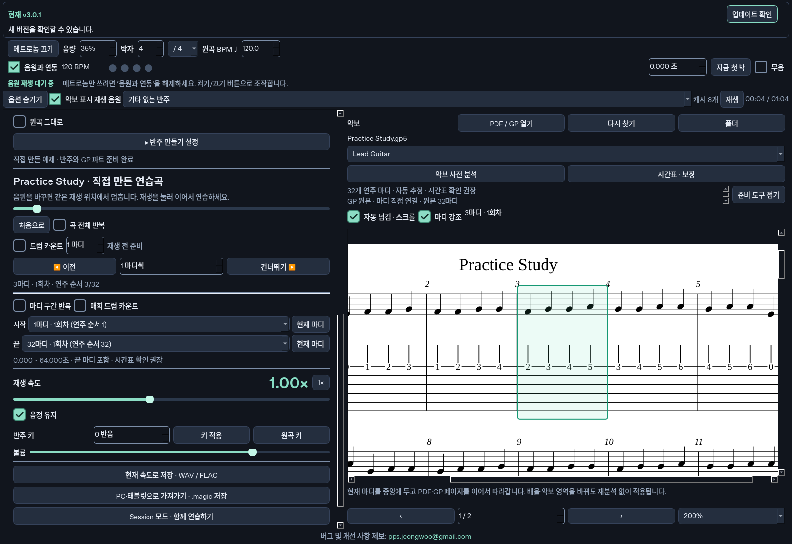
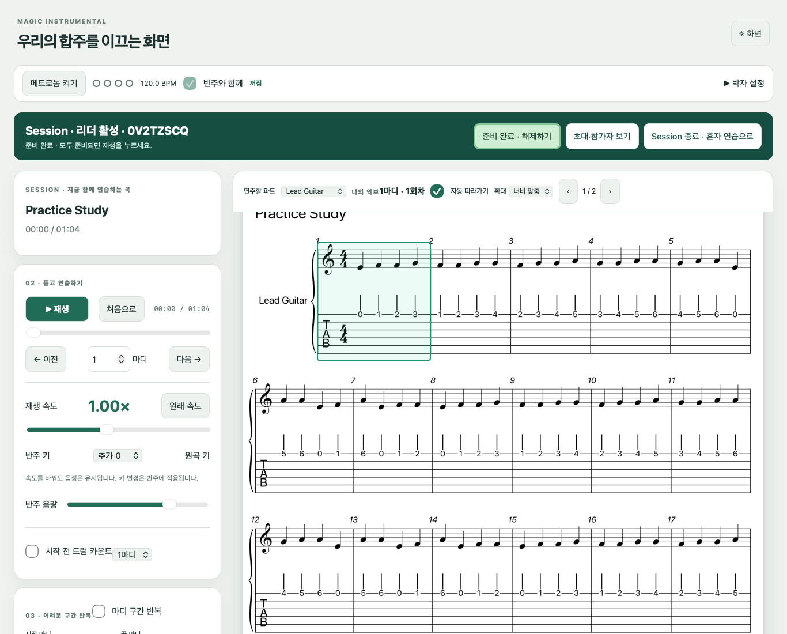

# Magic-Instrumental

**좋아하는 곡의 반주를 만들고, 악보를 보며 나의 속도로 연습하세요.**

Mac·Windows에서 보컬을 분리하고, 속도와 반주 키를 바꾸며 연습하는 무료 오픈소스 프로그램입니다. PDF 악보 또는 Guitar Pro의 원하는 파트를 함께 볼 수 있습니다. 준비한 곡은 `.magic` 파일 하나로 가져가 **iPad·Android에서도 재생**할 수 있습니다.

[소개·설치 안내](https://music-helper.duckdns.org/) · [English](README.en.md) · [자세한 사용법](docs/USER_GUIDE.md) · [태블릿 사용법](web_player/README.md) · [업데이트 내역](CHANGELOG.md) · [개발자 문서](CONTRIBUTING.md)

화면 예시는 직접 만든 연습곡과 악보로 촬영했습니다. 개인 음원이나 상업용 악보를 포함하지 않습니다.

## 처음 설치하기

Python·Java를 따로 설치하거나 명령어를 입력할 필요가 없습니다. 처음에는 인터넷 연결과 수 GB의 빈 공간이 필요합니다.

1. [최신 버전 받기](https://github.com/jeongwoo-gobroad/Magic-Instrumental/releases/latest)를 열어 **Magic-Instrumental-버전.zip**을 받습니다.
2. 받은 ZIP 파일을 **완전히 압축 해제**합니다.
3. 아래 표의 **처음 한 번** 파일을 더블클릭합니다. **설치 완료**가 나올 때까지 기다립니다.
4. 이후에는 **평소 실행** 파일을 더블클릭합니다.

| 사용하는 컴퓨터 | 처음 한 번 / 업데이트 후 | 평소 실행 |
|---|---|---|
| Apple Silicon Mac, macOS 14 이상 | `install.command` | `start.command` |
| Windows 10·11, x64 | `install.bat` | `start.bat` |

설치 파일이 Python, 반주 분리에 필요한 도구, 악보 인식 도구 **Audiveris·영어 인식 데이터**, GP 악보 표시 도구까지 자동으로 준비하고 확인합니다. 관리자 권한이나 전역 Python 설치를 요구하지 않습니다. 모델은 첫 반주를 만들 때 추가로 받습니다.

Mac에서 처음 열기가 차단되면 내려받은 출처를 확인한 뒤 Finder의 우클릭 → 열기 또는 시스템 설정 → 개인정보 보호 및 보안의 열기 안내를 따르세요. Windows에서는 ZIP 안의 파일을 바로 실행하지 말고 먼저 압축을 푸세요. [설치가 막힐 때](docs/USER_GUIDE.md)

## 첫 곡 연습하기

1. 직접 준비한 MP3·WAV·FLAC·M4A 등의 음원을 **`targets` 폴더**에 넣습니다.
2. 프로그램에서 **새로고침 → 곡 선택 → 선택한 곡의 반주 준비**를 누릅니다.
3. 준비가 끝나면 **재생**을 누릅니다. **재생 속도**를 낮춰 천천히 연습해 보세요.
4. 높낮이를 바꾸려면 **반주 키**의 반음 수를 정하고 **키 적용**을 누릅니다. `+2`는 두 반음 높게, `-2`는 두 반음 낮게입니다.

같은 파일을 다시 열면 저장된 반주를 바로 불러옵니다. 이름이 같아서 재사용하는 것이 아니라 파일 내용 전체가 같은지 확인합니다. 원본 음원을 덮어쓰지 않습니다.

## 악보 함께 보기

오른쪽 **PDF / GP 열기**에서 악보를 고르세요. 음원과 같은 이름으로 **`score_targets` 폴더**에 넣어도 자동으로 찾습니다. PDF와 GP가 동시에 있으면 사용할 악보를 직접 고르세요.

| 악보 | 어떻게 사용하나요? |
|---|---|
| PDF | 원본 화면을 표시하고, 사전 분석에서 음표·기호·마디를 읽습니다. |
| GP3·GP4·GP5 | PDF 없이 바로 엽니다. **파트 이름**에서 기타·베이스 등 원하는 파트를 고릅니다. 음표와 마디 정보를 직접 읽어 오선·타브 화면을 만듭니다. |

**확대 배율과 좌우 화면 너비를 정한 뒤 → 악보 사전 분석**을 누르세요. 분석이 끝나면 **시간표 · 보정**에서 반주와 마디가 맞는지 확인하고, **자동 넘김 · 스크롤**을 켭니다. GP에서 파트를 바꾼 경우에도 사전 분석이 필요합니다.

PDF는 각 마디에 한 파트의 오선 또는 타브가 배치된 구성을 지원 범위로 안내합니다. **오선과 타브가 함께 표시된 PDF는 지원하지 않습니다.** 타브 숫자만으로 음높이를 자동 판독하는 기능도 제공하지 않습니다. 복잡한 총보·불규칙한 인쇄·스캔이나 음원과 다른 편곡은 지원되지 않거나 수정이 필요할 수 있습니다. GP도 실제 음원과의 시간 맞춤은 추정 결과입니다. **PNG·JPG·JPEG 이미지 악보는 직접 지원하지 않습니다.** 사진·스캔 이미지를 넣은 PDF도 화질·기울기·번짐에 따라 인식이 어렵거나 실패할 수 있습니다. GPX·GP6/7/8 파일은 현재 지원하지 않습니다. 타악기 파트는 일정 BPM 방식으로 시간을 맞춥니다.

## 연습을 편하게 하는 기능

**Windows에서 GP 숫자가 검은 네모로 보였다면:** v2.1.1 이상으로 업데이트한 뒤 GP 파일을 다시 열고 **악보 사전 분석**을 실행하세요. 숫자와 글자를 악보에 도형으로 저장하도록 수정했습니다. 이미 만든 `.magic` 파일도 새로 저장해야 수정된 악보가 들어갑니다. 원본 음원·GP와 기존 보정 자료는 삭제하지 않습니다.

- **메트로놈**: 원곡 BPM과 박자를 입력하고 **음원과 연동**을 체크하면 배속에 맞춰 함께 움직입니다. 첫 박 위치를 지정할 수 있고, 음량은 반주와 별도로 조절합니다.
- **메트로놈만 사용**: **음원과 연동**을 해제하고 **메트로놈 켜기**를 누르세요. 곡 없이도 사용할 수 있습니다. 상단에 **단독 재생 중 / 음원 재생 대기 중** 등 현재 상태를 표시합니다. 연동을 켠 채 음원을 일시정지하면 클릭도 기다립니다.
- **드럼 카운트**: 시작하기 전에 몇 마디를 세어 줄지 정합니다.
- **이전 / 건너뛰기**: 한 번에 이동할 마디 수를 정합니다.
- **마디 구간 반복**: 시작·끝 마디를 골라 반복합니다. **매회 드럼 카운트**도 선택할 수 있습니다. 반복 기호로 돌아오는 마디는 회차로 구분합니다.
- **밝은 / 어두운 화면**: 위쪽에서 바꿉니다. 가운데 경계를 끌면 반주 조작부와 악보의 너비가 바뀝니다.
- **반주 만들기 설정**: 필요한 경우에만 펼쳐 분리 모델과 처리 장치를 고릅니다. 기본값은 자동 선택입니다.

## iPad·Android로 가져가기

**[▶ Magic Player 열기](https://jeongwoo-gobroad.github.io/Magic-Instrumental/)** · iPad는 Safari, Android는 Chrome으로 여세요.

컴퓨터에서 반주와 악보 분석을 마친 뒤 **태블릿으로 가져가기 · .magic 저장**을 누르세요. 이 파일에 반주, 원본 악보, GP 전체 파트의 악보 화면, 마디 시간표가 함께 들어갑니다. PDF에서 만들었든 GP에서 만들었든 모바일에서는 다시 분석하지 않습니다.

**모바일 메트로놈만 단독으로 쓸 때는 ‘반주와 함께’를 해제하고 켜세요.** 체크된 상태에서는 반주가 재생될 때만 클릭이 울립니다.

AirDrop·USB·파일 전송 등으로 `.magic`을 기기에 복사한 뒤 **Magic Player**에서 엽니다. 앱스토어 설치 없이 사용하며, 혼자 연습할 때는 기기 안의 파일만 읽습니다. Session 모드에서도 직접 공유 버튼을 누르지 않으면 파일을 서버로 올리지 않습니다. Safari·Chrome에서 웹주소를 처음 열어 홈 화면에 추가하면 오프라인으로 사용할 수 있습니다. [태블릿에서 시작하기](web_player/README.md)

**키는 두 곳에서 바꿀 수 있습니다.** 컴퓨터에서 키를 적용하고 저장하면 변경된 반주가 `.magic`에 들어갑니다. 모바일에서도 그 반주에 **추가 -12~+12반음**을 적용할 수 있습니다. 처음 열 때 추가 변경은 0이므로 키가 중복 적용되지 않습니다. 악보의 음표·타브 숫자를 이조하는 기능은 포함하지 않습니다.

## Session 모드로 함께 연습하기

**PC·iPad·Android에서 같은 반주를 맞춰 들으며 각자 다른 파트를 볼 수 있습니다.** 컴퓨터에서 새로 저장한 GP `.magic`에는 **모든 파트**가 들어갑니다. 재생기의 **연주할 파트**에서 바꿔도 반주 위치는 유지됩니다. 예전 단일 파트 파일도 계속 열립니다.

1. 데스크톱의 **Session 모드 · 함께 연습하기**를 누르거나 [웹 재생기](https://jeongwoo-gobroad.github.io/Magic-Instrumental/)를 엽니다. PC도 합주 중에는 이 웹 화면을 사용합니다.
2. 리더는 `.magic`을 열고 **Session 모드 → 리더 모드 켜기**를 누릅니다. 8자리 초대 코드 또는 QR을 팀원에게 알려 줍니다.
3. 멤버는 **멤버 모드 켜기**로 참가해 **리더 파일 받기** 또는 **내 .magic 파일 선택**을 사용합니다. 리더가 파일을 보내려면 **내 GP 전체 파트 파일 공유**를 먼저 누릅니다.
4. 각자 자기 파트를 고르고 **합주 준비**를 누릅니다. 리더가 재생하면 연결 상태에 따라 **1~5초 뒤** 같은 시점에 시작합니다.

Session을 켜면 **리더용 팀 제어 화면 / 멤버용 악보 중심 화면**으로 바뀝니다. 재생·일시정지·마디 이동은 리더가, 파트·확대·자기 음량은 각자가 조절합니다. 속도·키·반복 구간은 리더가 일시정지 후 설정합니다. **Session 종료 · 혼자 연습으로**를 누르면 원래 화면으로 돌아옵니다.

각자 파일을 쓸 때는 **같은 원곡 음원 파일로 만든 반주**여야 합니다. 편집·길이·앞부분이 다른 녹음은 합주 기준으로 사용할 수 없습니다. 악보와 파트는 달라도 됩니다. 악보 시간이 맞는지는 PC에서 먼저 검토하세요.

인터넷과 켜진 화면이 필요합니다. 누군가 화면을 잠그거나 연결이 끊기면 합주가 멈춥니다. 유선·블루투스 스피커의 출력 지연까지 자동 보정하지는 않습니다. 리더가 공유한 파일만 중계 서버에 잠시 저장되며, 방 종료·4시간 만료·서버 재시작 때 삭제됩니다. [자세한 Session 사용법](web_player/README.md#session-모드로-함께-연습하기)

## 자료·라이선스·알아둘 점

**음원과 악보는 제공하지 않습니다.** 사용자가 정당한 대가를 지불해 구매하는 등 적법한 이용 권한을 확보한 자료를 직접 준비해야 합니다. 무료 자료도 해당 이용 조건을 따라야 합니다. 구매한 자료라도 원본·반주·악보가 들어간 `.magic`을 다른 사람에게 배포할 권한이 생기는 것은 아닙니다.

프로그램의 자체 코드와 문서는 **GPL-3.0-only**입니다. 사용한 모델과 외부 도구는 각각의 원래 라이선스를 따릅니다. PDF 인식에는 [Audiveris](https://github.com/Audiveris/audiveris), GP 읽기에는 [PyGuitarPro](https://github.com/Perlence/PyGuitarPro), GP 표시에 [Verovio](https://www.verovio.org/), 모바일 배속·키 변경에는 [Signalsmith Stretch](https://github.com/Signalsmith-Audio/signalsmith-stretch)를 사용합니다. [라이선스와 모델 출처](THIRD_PARTY_NOTICES.md)

보컬 분리와 악보 인식은 항상 완벽하지 않습니다. 모델의 보편적인 성능 우위를 주장하지 않습니다. DRM 파일·스트리밍 앱 내부 다운로드는 지원하지 않습니다. Windows NVIDIA GPU와 Apple Silicon GPU를 지원하지만, 실제 GPU·오디오 장치·모바일 기기별 동작은 달라질 수 있습니다. 검증 범위와 개발 안내는 [개발자 문서](CONTRIBUTING.md)에 따로 정리했습니다.
