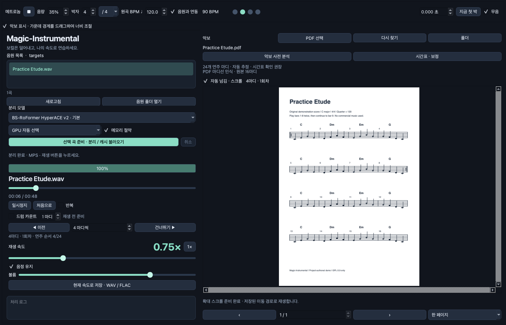
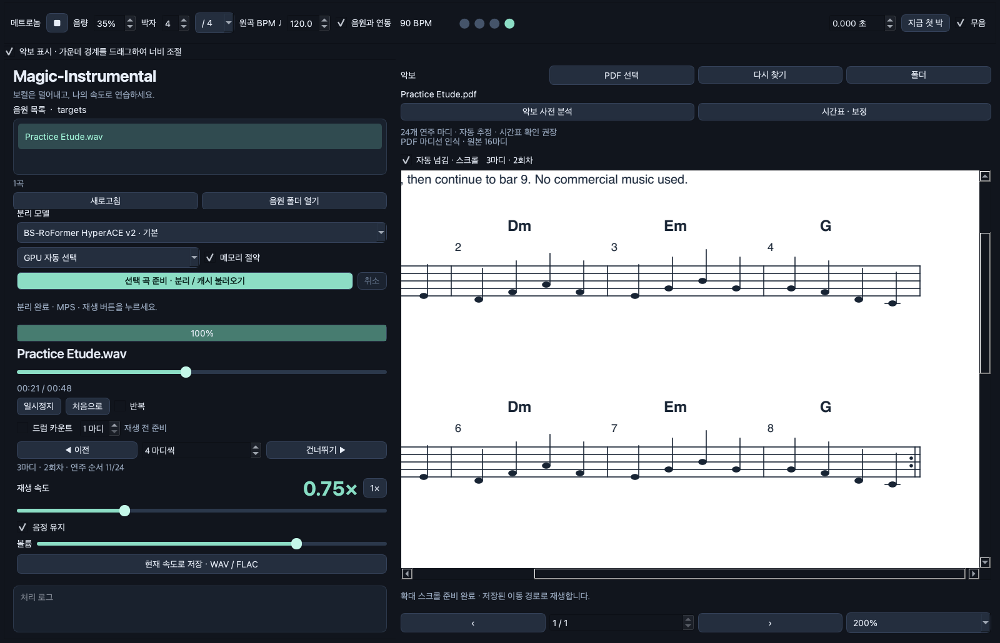
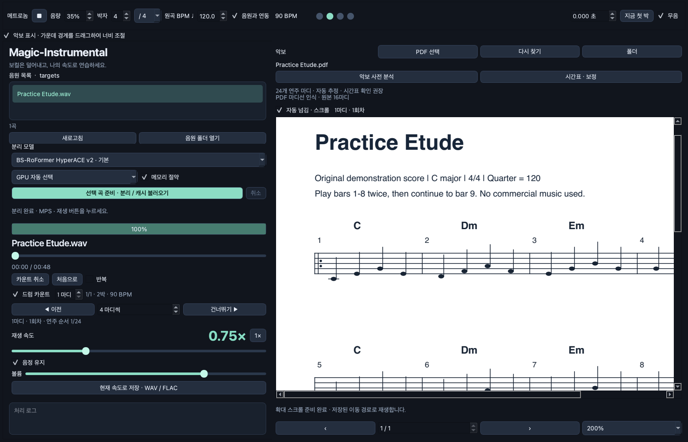

# Magic-Instrumental

**보컬을 분리하고, 반주·악보·메트로놈을 한 화면에서 연습하세요.**

Python으로 만든 macOS / Windows용 데스크톱 앱입니다. 보컬을 제거한 인스트루먼탈을 음정 유지 상태로 **0.25~2배속** 재생하고, 미리 분석한 PDF 악보를 재생 위치에 맞춰 넘깁니다. 인터페이스는 한국어입니다.

[English overview](README.en.md) · [상세 사용법](docs/USER_GUIDE.md) · [업데이트 내역](CHANGELOG.md) · [개발자 안내](CONTRIBUTING.md)

> **음원과 악보는 제공하지 않습니다.** 사용자는 정당한 대가를 지불해 구매하는 등 적법한 방법으로 이용 권한을 확보한 음원·악보를 직접 준비해야 합니다. 무료 배포 자료도 해당 이용 조건을 준수해야 합니다. 음원·악보의 구매가 재배포 권한까지 주는 것은 아닙니다. 타인의 원본이나 분리 결과물을 허락 없이 공유하지 마세요.

## 작동 화면



상단 메트로놈, 왼쪽 반주·배속·마디 이동, 오른쪽 PDF 악보를 한 화면에서 조작합니다.



200% 확대에서 저장된 이동 경로를 따라가는 모습입니다. **캡처는 실제 앱에 직접 만든 합성 연습곡·예제 악보를 넣어 촬영한 것으로, 개인 음원이나 상업용 악보를 포함하지 않습니다.**

## v1.4.0 드럼 카운트 후 재생

재생 버튼 아래 **드럼 카운트**를 켜고 **1~4마디**를 선택하면, 상단의 **원곡 BPM·박자·첫 박 위치**와 현재 배속에 맞춰 예비 박을 들은 뒤 현재 위치에서 음악이 시작됩니다. 예를 들어 120 BPM, 4/4박자, 1마디는 1배속에서 2초, 0.5배속에서 4초입니다. 끄면 즉시 재생하며, 선택은 앱을 다시 열어도 유지됩니다.

음원 연동 체크 없이도 사용할 수 있고, 카운트 음량·무음은 상단 메트로놈 설정을 따릅니다. 카운트 동안 일반 메트로놈 소리는 잠시 멈추며 원형 표시로 현재 박을 보여줍니다. 중간 박에서 시작하면 해당 박 번호에 맞춰 세고 마지막 간격을 줄여 현재 위치로 연결합니다. 원본 재생 위치나 첫 박 설정은 바꾸지 않습니다.

카운트 중 **카운트 취소**를 누르거나 모드를 끄면 음악도 시작하지 않습니다. 위치 이동·곡 변경·BPM/박자/배속 변경도 진행 중인 카운트를 취소합니다. 일시정지 후 재생 버튼을 누르면 다시 카운트하며, 재생 중 탐색과 자동 반복에는 카운트를 끼워 넣지 않습니다. 오디오 장치에 따른 시작 지연이 있을 수 있으며 녹음용 정밀 동기화 기능은 아닙니다.



## v1.3.0 악보 인식 도구 자동 설치

**설치 파일을 더블클릭하면 Audiveris 5.11.0, 포함된 Java, 영어 OCR 데이터까지 준비합니다.** 별도 프로그램 설치나 언어 설정, 명령어 입력이 필요하지 않습니다. 공식 다운로드의 SHA-256을 확인하고 합성 악보의 영어 제목을 실제로 읽는 검사까지 통과해야 설치 완료를 표시합니다. 실패하거나 파일이 손상되면 같은 설치 파일을 다시 실행하세요. 기존 음원·악보·검토한 시간표는 보존됩니다.

## 메트로놈 동기화·음량

**음원과 연동**을 체크하고 원곡 BPM·박자·첫 박 위치를 정하면 음악 재생과 함께 클릭이 시작됩니다. 탐색 막대, 처음으로, 이전/다음 마디, 시간표 이동, 곡 반복에서도 해당 위치의 박과 강박을 유지합니다. 박 중간으로 이동하면 다음 박 경계부터 클릭하며, 일시정지 후 재개와 재생 위치 보정으로 같은 박이 중복 울리는 것을 방지합니다. 음원은 자동으로 재생하지 않습니다. 클릭만 끄려면 메트로놈의 ■를 누르세요. 상단 **음량 0~100%**로 음원과 별도로 클릭 크기를 조절합니다. 기본값은 35%이며, 곡을 바꾸거나 앱을 다시 실행해도 유지됩니다. **무음**은 선택한 음량을 보존하고 소리만 잠시 끕니다.

## v1.1.0 악보 인식 개선

GP5 인쇄본처럼 줄바꿈 정보가 없는 PDF도 **실제 보표와 마디선**을 읽어 마디·페이지·확대 스크롤을 연결합니다. A4/A3/Letter 등 용지 크기, 가로·세로·혼합 규격, 짧은 마지막 줄, 5선/6선 보표, 약간 기울어진 스캔을 처리합니다. PDF에서 위치를 확인한 반복 점과 D.C./D.S./Segno/To Coda/Coda/Fine 문자도 OMR 결과에 보충합니다.

음표와 복잡한 기호 인식에는 여전히 Audiveris 또는 같은 악곡·파트 구성의 MusicXML이 필요합니다. 모든 스캔·타브 악보의 완전 자동 인식을 보장하지 않습니다. 마디 수나 보표 구성이 맞지 않으면 보조 배치 또는 보정 안내를 사용합니다. 업데이트 후 설치 파일을 한 번 실행하고 **악보 사전 분석**을 다시 실행하세요. 기존 시간 보정을 유지하려면 **화면 이동 경로만 분석**을 선택합니다. 기호까지 다시 인식하려면 이 선택을 해제합니다.

## 처음 설치하기

Python이나 Java를 미리 설치할 필요가 없습니다. 설치 파일이 Python **3.12.14**, 필요한 패키지, FFmpeg, **Audiveris와 영어 OCR 데이터**를 사용자 전용 폴더에 준비합니다. 관리자 권한이나 전역 Python 패키지 설치가 필요하지 않습니다. 최초 설치에는 인터넷 연결과 수 GB의 여유 공간이 필요합니다. 모델은 첫 곡 처리 시 추가로 다운로드합니다.

1. [최신 릴리스](https://github.com/jeongwoo-gobroad/Magic-Instrumental/releases/latest)의 **Magic-Instrumental-버전.zip**을 받습니다. **Code → Download ZIP**으로 개발 중인 소스를 받을 수도 있습니다.
2. ZIP을 **완전히 압축 해제**합니다. Windows에서는 ZIP 안에서 바로 실행하지 마세요.
3. 아래에서 운영체제에 맞는 설치 파일을 더블클릭합니다.

| 환경 | 처음 설치 / 업데이트 후 설치 | 평소 실행 |
|---|---|---|
| Apple Silicon Mac, macOS 14 이상 | **`install.command`** | **`start.command`** |
| Windows 10/11, x64 | **`install.bat`** | **`start.bat`** |

설치 창에 **설치 완료**가 나올 때까지 기다린 뒤 시작 파일을 더블클릭하세요. 설치하지 않고 시작한 경우에도 환경이 없으면 설치부터 진행합니다. 이미 설치된 앱의 시작 파일은 패키지를 다시 설치하지 않습니다.

**Mac에서 처음 열기가 차단되는 경우:** 내려받은 출처를 확인하고 Finder에서 파일을 우클릭 → 열기를 사용하거나, 시스템 설정 → 개인정보 보호 및 보안의 해당 파일 열기 안내를 따르세요. 실행 권한이 유실되었다면 터미널에 `zsh `를 입력한 뒤 `install.command`를 끌어다 놓고 Enter를 누르면 설치할 수 있습니다. 시작 파일도 같은 방식입니다. 시스템 보안 기능 전체를 끌 필요는 없습니다.

**Windows에서 설치 폴더를 바꾸려면:** 설치 전에 `venv-location.windows.example.txt`를 복사해 `venv-location.windows.txt`로 이름을 바꾸고, 주석 아래 한 줄을 원하는 **프로젝트 밖 절대 경로**로 수정하세요. 예: `D:\PythonEnvs\Magic-Instrumental\.venv`. 따옴표는 넣지 않습니다. 생략하면 설치기가 기본 설정 파일을 만듭니다. 이 개인 설정 파일은 Git에 포함되지 않습니다.

가상환경 위치는 Mac에서 `~/.vocal-separator-and-speed-adj/.venv`, Windows 기본값은 `%LOCALAPPDATA%\Magic-Instrumental\.venv`입니다. Mac의 폴더 이름은 이전 설치와의 호환을 위해 유지합니다. Python 본체와 설치 도구도 사용자 폴더 안에 보관하고, 시스템 PATH·셸 설정·Windows Python 레지스트리는 변경하지 않습니다.

악보 인식 도구는 Mac의 `~/.vocal-separator-and-speed-adj/tools/`, Windows의 `%LOCALAPPDATA%\Magic-Instrumental\tools\` 아래에 별도로 보관합니다. Windows 가상환경 위치를 바꿔도 이 도구 위치는 유지됩니다. 다른 곳에 이미 설치한 Audiveris는 덮어쓰지 않습니다. 평소 시작 파일에서는 다운로드나 인식 검사를 반복하지 않습니다.

NVIDIA 드라이버가 감지되는 Windows에서는 CUDA 13.0 PyTorch를 설치합니다. NVIDIA GPU가 없으면 CPU, Apple Silicon에서는 MPS를 사용합니다. GPU 드라이버는 사용자가 준비해야 하며 별도 CUDA Toolkit은 필요하지 않습니다. CPU로 설치하려면 명령 프롬프트에서 `install.bat -Cpu`, CUDA를 명시하려면 `install.bat -Cuda`를 실행하세요. 선택한 설치 방식은 다음 실행에도 유지됩니다. Intel Mac과 Windows ARM은 이 릴리스의 지원 대상이 아닙니다.

## 첫 곡 연습하기

1. 직접 준비한 음원을 **`targets/`**에 넣습니다.
2. 시작 파일로 앱을 열고 **새로고침 → 곡 선택 → 선택 곡 준비**를 누릅니다.
3. 최초 모델 다운로드와 보컬 분리가 끝나면 **재생**을 누릅니다.
4. 배속 슬라이더를 조절합니다. **음정 유지**가 기본이며, **현재 속도로 저장**으로 WAV/FLAC 연습 파일을 만들 수 있습니다.

MP3, WAV, FLAC, M4A/AAC, OGG/Opus, AIFF, WMA 등 FFmpeg가 디코딩하는 여러 형식을 처리합니다. DRM으로 보호된 파일이나 스트리밍 서비스의 다운로드 캐시는 지원하지 않습니다. 분리는 곡 전체를 먼저 처리하므로 첫 처리 시간은 곡 길이·모델·장치에 따라 다릅니다.

같은 음원은 파일 전체의 **SHA-256**과 모델·처리 설정을 확인해 캐시를 재사용합니다. 이름이 바뀌어도 바이트가 같으면 재분리하지 않습니다. 태그 변경이나 재인코딩으로 파일 내용이 달라지면 새 파일로 처리합니다. 처리 결과는 `processed/`에 저장합니다.

## 악보와 메트로놈

- **악보:** 음원 `targets/Practice Song.mp3`와 같은 이름으로 `score_targets/Practice Song.pdf`를 넣으면 우측에 표시합니다. 가운데 경계를 드래그해 곡 컨트롤러와 악보의 비율을 바꿀 수 있습니다.
- **확대·자동 스크롤:** 창 크기와 최대 600% 확대 배율을 먼저 정한 뒤 **악보 사전 분석**을 실행합니다. 도돌이표·엔딩·D.C./D.S.·코다, 음원과 마디의 시간 관계, 확대 화면 이동 경로를 재생 전에 계산합니다.
- **마디 이동:** 유효한 분석 시간표가 있으면 **이전 / N마디씩 / 건너뛰기**로 실제 연주 순서상의 마디를 이동합니다. N은 1~10,000입니다.
- **메트로놈:** 상단 원형 표시로 박자를 따라갈 수 있습니다. 독립 재생 또는 **음원과 연동**을 선택하고, 원곡 BPM을 입력하면 `원곡 BPM × 음원 배속`으로 움직입니다. 박자 수·분모·첫 박 위치·클릭 음량·무음을 조절할 수 있습니다. 체크하면 음원 재생을 기다렸다 함께 시작하고, 앞뒤 탐색 후에도 첫 박 기준을 유지합니다.

PDF 표시와 기호 인식에 필요한 준비는 **기본 설치 파일에서 모두 처리합니다.** Audiveris를 따로 열어 영어를 설치할 필요가 없습니다. 같은 이름의 MusicXML(`.musicxml`, `.mxl`, `.xml`)을 함께 준비하면 OMR 단계를 생략할 수 있습니다. [악보 설치·보정 상세 안내](docs/USER_GUIDE.md#악보-설치와-사전-분석)를 참고하세요.

**악보 자동 인식과 음원 정렬은 추정입니다.** 특히 반복·코다 기호, 복잡한 편곡, 훼손된 스캔, 기타 TAB에서 수정이 필요할 수 있습니다. 연주 순서와 시간표를 확인하세요. 배율이나 패널 크기를 바꾸면 기존 마디 시간을 유지한 채 화면 이동 경로만 다시 분석할 수 있습니다. 메트로놈은 사용자가 입력한 일정 BPM을 사용하며 템포 변화를 자동 추적하지 않습니다.

## 폴더 구성과 개인정보

```text
Magic-Instrumental/
├── install.command / install.bat    # Python·패키지·Audiveris·영어 OCR 설치
├── start.command / start.bat        # 앱 실행
├── targets/                        # 직접 준비한 음원
├── score_targets/                  # 직접 준비한 PDF, 선택적 MusicXML
├── processed/                      # 분리 결과·악보 시간표·개인 설정
├── models/                         # 첫 사용 시 내려받는 모델
├── practice_player/                # 앱 소스
└── tests/                          # 합성 신호를 사용하는 테스트
```

음원·악보는 이 앱이 외부 서버에 업로드하지 않고 로컬에서 처리합니다. 설치와 모델 다운로드에는 외부 배포 서버에 접속합니다. `targets/`, `score_targets/`, `processed/`, `models/`의 내용과 개인 경로 설정은 공개 소스·배포 ZIP에서 제외합니다. 모델 가중치와 유료 콘텐츠는 저장소에 포함하지 않습니다. 직접 지정한 Google Drive·OneDrive 등의 폴더 동기화는 해당 서비스 설정을 따릅니다.

## 업데이트와 문제 해결

새 소스 ZIP을 별도 폴더에 압축 해제하고 `targets/`, `score_targets/`, `processed/`, `models/`와 Windows 개인 경로 설정을 필요한 경우 복사한 뒤 **설치 파일을 다시 실행**하세요. 원본은 보관하고, 호환되는 캐시는 자동 재사용합니다. 버전별 변경은 [CHANGELOG.md](CHANGELOG.md)에 기록합니다.

설치 중 다운로드가 실패하면 인터넷 연결을 확인하고 설치 파일을 다시 실행하세요. 메모리가 부족하면 앱의 **메모리 절약** 옵션을 사용하세요. NVIDIA 드라이버와 CUDA가 맞지 않으면 드라이버를 갱신하거나 `install.bat -Cpu`로 전환할 수 있습니다. [상세 문제 해결](docs/USER_GUIDE.md#문제-해결) 및 [개발·테스트 안내](CONTRIBUTING.md)를 제공합니다. 이슈에 음원·악보·개인 절대 경로가 포함된 로그를 그대로 올리지 마세요.

Apple Silicon에서 설치·GUI·실제 모델 추론을 확인했습니다. Windows용 의존성 해석과 자동 검증을 제공하지만 Windows 실기기 오디오 및 NVIDIA 추론은 별도 검증이 필요합니다. 모든 음원에서 보컬이 완전히 없어지거나 모든 악보가 정확하게 인식된다고 보장하지 않습니다.

## 배속과 음정 유지

실시간 재생은 Qt `QMediaPlayer`의 배속·피치 보정 기능을 사용합니다. 기본 FFmpeg 백엔드의 피치 보정은 [Signalsmith Stretch](https://doc.qt.io/qt-6/qtmultimedia-attribution-signalsmith-stretch.html)에 기반합니다. 파일 저장은 FFmpeg [`atempo`](https://ffmpeg.org/ffmpeg-filters.html#atempo)의 WSOLA 방식으로 처리하며, 0.25배속은 0.5배속 필터 두 개를 연결합니다. 예를 들어 440Hz 음을 0.5배속으로 처리하면 길이는 약 두 배가 되고 음높이는 유지됩니다.

재생과 저장은 다른 처리기를 사용하므로 결과가 완전히 같지는 않을 수 있습니다. 현재 기능은 배속 중 음정 유지이며 별도의 반음 단위 조옮김은 없습니다. 매우 느린 배속에서는 처리 흔적이 들릴 수 있습니다.

## Audiveris 사용 및 라이선스

이 프로젝트는 PDF의 음표·음악 기호를 MusicXML로 변환하는 데 **[Audiveris](https://github.com/Audiveris/audiveris)**를 활용합니다. Audiveris 개발자와 기여자들의 작업에 감사드립니다. 별도로 설치한 Java 프로그램을 명령행으로 호출하며, Python 패키지로 내장하거나 Audiveris 실행 파일·소스를 이 배포본에 포함하지 않습니다. 같은 곡의 MusicXML이 있으면 이 인식 단계를 생략합니다.

**자동 다운로드·설치를 제공하는 것 자체가 금지된 것은 아닙니다.** 설치기는 공식 Audiveris 배포본과 Tesseract 영어 데이터를 사용자 PC에서 직접 내려받고, 원본 프로그램과 포함된 Java·외부 구성요소의 고지를 보존합니다. Audiveris의 AGPL 및 영어 데이터의 [Apache-2.0 라이선스](https://github.com/tesseract-ocr/tessdata/blob/ced78752cc61322fb554c280d13360b35b8684e4/LICENSE) 전문과 출처도 도구 폴더의 `licenses/`, `sources.json`에 저장합니다. 이 저장소의 ZIP에는 설치 코드만 포함합니다. 실행 파일을 직접 재포장·재배포하거나 수정한 서비스를 제공하는 경우의 의무는 별도로 확인해야 합니다.

Audiveris는 **GNU Affero General Public License v3 또는 이후 버전 (`AGPL-3.0-or-later`)**입니다. [라이선스 전문](https://github.com/Audiveris/audiveris/blob/master/LICENSE)과 [원본 소스 헤더의 버전 허용 문구](https://github.com/Audiveris/audiveris/blob/master/app/src/main/java/org/audiveris/omr/Main.java)를 확인했습니다. Audiveris를 수정·재배포하거나 서비스로 제공할 때는 해당 라이선스의 소스 제공·고지 및 적용되는 네트워크 이용 조건을 준수해야 합니다. 본 프로젝트의 GPL 표기는 Audiveris의 라이선스를 변경하지 않습니다.

## 라이선스와 모델

이 프로젝트의 자체 코드와 문서는 **GNU GPL v3.0 only (`GPL-3.0-only`)**로 배포합니다. [LICENSE](LICENSE)의 전문을 확인하세요. 수정·재배포 시 GPL-3.0의 소스 제공 및 고지 조건을 따라야 합니다.

**모델 가중치와 외부 라이브러리에는 각각의 라이선스가 적용됩니다. 앱의 GPL은 모델·음원·악보의 이용 권한을 부여하지 않습니다.**

| 모델 | 역할 | 가중치 이용 조건 |
|---|---|---|
| [BS-RoFormer HyperACE v2 vocals](https://huggingface.co/pcunwa/BS-Roformer-HyperACE) | 기본 모델 | 확인한 제작자 카드에 명시적 가중치 라이선스가 없어 이용·상업화·재배포 허가를 임의로 가정할 수 없습니다. 제작자에게 조건을 확인해야 합니다. |
| [Mel-Band RoFormer deux](https://huggingface.co/becruily/mel-band-roformer-deux) | 악기 보존 비교 모델 | **CC BY-NC 4.0**, 비상업적 이용 조건 및 저작자 표시 등 해당 라이선스 준수 필요 |

2026년 11월 공개 자료를 검토해 선정했으며 모든 모델에 대한 절대적 최고 성능을 주장하지 않습니다. 가중치는 제작자의 저장소에서 고정 리비전으로 내려받아 체크섬을 검증합니다. 자세한 출처·고정 버전·외부 도구 라이선스는 [THIRD_PARTY_NOTICES.md](THIRD_PARTY_NOTICES.md), AI 개발 인계는 [AI_CODER_README.md](AI_CODER_README.md)를 참조하세요.
