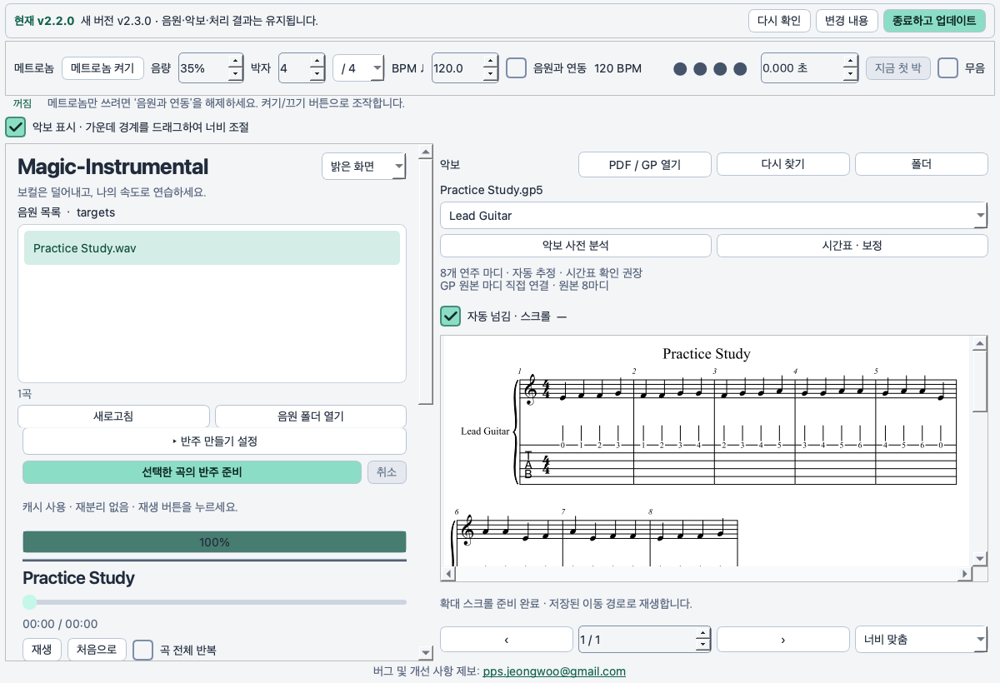

# Magic-Instrumental

**좋아하는 곡의 반주를 만들고, 악보를 보며 나의 속도로 연습하세요.**

Mac·Windows에서 보컬을 분리하고, 속도와 반주 키를 바꾸며 연습하는 무료 오픈소스 프로그램입니다. PDF 악보 또는 Guitar Pro의 원하는 파트를 함께 볼 수 있습니다. 준비한 곡은 `.magic` 파일 하나로 가져가 **iPad·Android에서도 재생**할 수 있습니다.

현재 버전: **2.4.5** · Mac / Windows / 웹 재생기

[소개·설치 안내](https://music-helper.duckdns.org/) · [English](README.en.md) · [자세한 사용법](docs/USER_GUIDE.md) · [태블릿 사용법](web_player/README.md) · [업데이트 내역](CHANGELOG.md) · [개발자 문서](CONTRIBUTING.md)

작은 창에서는 왼쪽을 아래로 스크롤하면 저장 기능까지 볼 수 있습니다. 악보를 더 넓게 보려면 가운데 경계를 왼쪽으로 끄세요. 위아래 공간이 좁으면 악보 쪽의 **준비 도구 접기**를 누르세요. 같은 자리에서 도구를 다시 펼칠 수 있습니다.

화면 예시는 직접 만든 연습곡과 악보로 촬영했습니다. 개인 음원이나 상업용 악보를 포함하지 않습니다.

## 처음 설치하기

Python·Java를 따로 설치하거나 명령어를 입력할 필요가 없습니다. 처음에는 인터넷 연결과 수 GB의 빈 공간이 필요합니다.

1. [최신 버전 받기](https://github.com/jeongwoo-gobroad/Magic-Instrumental/releases/latest)를 열어 **Magic-Instrumental-버전.zip**을 받습니다.
2. 받은 ZIP 파일을 **완전히 압축 해제**합니다.
3. 아래 표의 **처음 한 번** 파일을 더블클릭합니다. **설치 완료**가 나올 때까지 기다립니다.
4. 이후에는 **평소 실행** 파일을 더블클릭합니다.

| 사용하는 컴퓨터 | 처음 한 번 | 평소 실행 |
|---|---|---|
| Apple Silicon Mac, macOS 14 이상 | `install.command` | `start.command` |
| Windows 10·11, x64 | `install.bat` | `start.bat` |

설치 파일이 Python, 반주 분리에 필요한 도구, 악보 인식 도구 **Audiveris·영어 인식 데이터**, GP 악보 표시 도구까지 자동으로 준비하고 확인합니다. 관리자 권한이나 전역 Python 설치를 요구하지 않습니다. 모델은 첫 반주를 만들 때 추가로 받습니다.

**Mac에서 처음 실행할 때** `install.command`를 더블클릭한 뒤 개발자를 확인할 수 없다는 안내로 실행이 차단되면, 이 프로젝트의 공식 릴리스에서 받은 파일인지 확인하세요. **Apple 메뉴() → 시스템 설정 → 개인정보 보호 및 보안**을 열고, 아래쪽 **보안**에서 해당 파일 이름 옆의 **그래도 열기**를 누릅니다. 화면의 안내에 따라 실행을 승인하세요. 나중에 `start.command`도 처음 열 때 같은 안내가 뜨면 그 파일에 대해 한 번 더 허용하세요. [Apple 한국어 안내 · Mac에서 앱 안전하게 열기](https://support.apple.com/ko-kr/102445)

Windows에서는 ZIP 안의 파일을 바로 실행하지 말고 먼저 압축을 푸세요. [설치가 막힐 때](docs/USER_GUIDE.md)

## 기존 자료를 유지하며 업데이트하기

**Windows에서 ‘새 버전 확인 중’ 멈추거나 창이 꺼진다면:** 프로그램과 오류 창을 닫고 기존 폴더의 **`update.bat`**을 더블클릭해 v2.3.1 이상으로 업데이트한 뒤 **`start.bat`**으로 실행하세요. 프로그램 안의 업데이트 버튼을 누를 필요가 없습니다. 음원·악보·처리 결과를 삭제하거나 다시 설치할 필요도 없습니다.

프로그램을 실행하면 상단에 **현재 버전**과 **새 버전 확인 결과**가 표시됩니다. 새 버전이 있으면 **변경 내용**을 확인하고 **종료하고 업데이트**를 누르세요. 업데이트 창이 열리고 프로그램이 종료됩니다. **업데이트 완료** 후 평소 쓰던 `start` 파일로 다시 실행합니다. 음원·악보·처리 결과는 유지합니다.

확인은 실행을 막지 않으며, 인터넷 연결이 안 되어도 연습할 수 있습니다. **다시 확인**으로 재시도할 수 있고, 반주 생성·악보 분석·저장 중에는 작업 완료 후 업데이트합니다. 자동으로 프로그램을 설치하거나 재생을 중단하지 않습니다.

GUI 버튼 대신 프로그램을 종료한 뒤, 평소 실행하던 폴더의 **Mac `update.command` / Windows `update.bat`**을 더블클릭하세요. **업데이트 완료**가 나오면 같은 폴더의 `start` 파일로 실행합니다. 필요한 도구도 자동으로 확인하므로 `install`을 따로 실행할 필요가 없습니다.

**구버전이라 update 파일이 없다면:** [기존 사용자용 업데이트 도구 ZIP](https://github.com/jeongwoo-gobroad/Magic-Instrumental/releases/latest/download/Magic-Instrumental-Updater.zip)을 받아 완전히 압축 해제하고, 그 안의 `update` 파일을 더블클릭하세요. 폴더 선택 창에서 **기존 `start` 파일과 `targets`가 들어 있는 프로그램 폴더**를 고릅니다. 이후에는 그 기존 폴더 안에 생긴 `update` 파일을 사용합니다.

음원(`targets`), 악보(`score_targets`), 처리 결과·보정 시간표(`processed`), 모델(`models`), 저장한 `.magic`과 개인 설정을 유지합니다. 기존 폴더를 삭제하거나 자료를 옮기지 마세요. 인터넷이 필요하며, 실패하거나 중단되면 같은 업데이트 파일을 다시 실행하세요. [자세한 업데이트 순서](docs/UPDATING.md)

## 첫 곡 연습하기

1. 직접 준비한 MP3·WAV·FLAC·M4A 등의 음원을 **`targets` 폴더**에 넣습니다.
2. 프로그램에서 **새로고침 → 곡 선택 → 선택한 곡의 반주 준비**를 누릅니다.
3. 준비가 끝나면 곡의 전체 시간이 표시됩니다. **재생**을 누르고 **재생 속도**를 낮춰 천천히 연습해 보세요.
4. 높낮이를 바꾸려면 **반주 키**의 반음 수를 정하고 **키 적용**을 누릅니다. `+2`는 두 반음 높게, `-2`는 두 반음 낮게입니다.

같은 파일을 다시 열면 저장된 반주를 바로 불러옵니다. 이름이 같아서 재사용하는 것이 아니라 파일 내용 전체가 같은지 확인합니다. 원본 음원을 덮어쓰지 않습니다.

Windows에서는 첫 반주가 준비되면 바로 **키 적용**을 누를 수 있습니다. 긴 분리·분석 도중 **취소**를 누르면 해당 작업과 함께 실행한 변환 도구도 종료됩니다. 완료된 반주는 다음에 다시 사용할 수 있습니다.

## 악보 함께 보기

오른쪽 **PDF / GP 열기**에서 악보를 고르세요. 음원과 같은 이름으로 **`score_targets` 폴더**에 넣어도 자동으로 찾습니다. PDF와 GP가 동시에 있으면 사용할 악보를 직접 고르세요.

| 악보 | 어떻게 사용하나요? |
|---|---|
| PDF | 원본 화면을 표시합니다. 제공된 MusicXML을 먼저 읽고, 없으면 PDF 음표·기호를 인식합니다. 자동 모드에서 OMR 인식이 어려운 경우에만 마디선·BPM 추정을 사용합니다. |
| GP3·GP4·GP5 | PDF 없이 바로 엽니다. **파트 이름**에서 기타·베이스 등 원하는 파트를 고릅니다. 음표와 마디 정보를 직접 읽어 오선·타브 화면을 만듭니다. |

**확대 배율과 좌우 화면 너비를 정한 뒤 → 악보 사전 분석**을 누르세요. 분석이 끝나면 **시간표 · 보정**에서 반주와 마디가 맞는지 확인하고, **자동 넘김 · 스크롤**을 켭니다. GP에서 파트를 바꾼 경우에도 사전 분석이 필요합니다.

**마디 강조는 기본으로 켜져 있습니다.** PDF와 GP 악보의 현재 마디 전체에 초록 테두리와 옅은 음영을 표시합니다. PC와 웹의 **마디 강조**를 끄면 강조 영역만 즉시 숨기고, 다시 켜면 재분석 없이 현재 마디를 보여 줍니다. 선택은 PC 앱과 각 웹 브라우저가 따로 기억하며, 곡이나 파트를 바꾸어도 유지합니다.

**자동 넘김 · 스크롤**은 화면 이동을 정하는 별도 설정입니다. 마디 번호와 반복 회차는 강조 표시나 자동 넘김을 꺼도 계속 갱신합니다. 강조를 켠 상태에서 직접 다른 페이지를 보고 있으면 강조 영역은 숨기고, 현재 마디의 페이지로 돌아오면 다시 보여 줍니다. 일시정지하면 표시를 유지하고, 마디 이동·반복·코다에서는 재생 위치에 맞춰 바뀝니다.

**강조를 켰는데 예전 분석에 마디 위치가 없다는 안내가 나오면:** **악보 사전 분석 → 기존 마디 시간표 유지 · 화면 이동 경로만 분석**을 실행하세요. 보정한 시간표를 유지하며 마디 위치를 추가하고, 음표 인식이나 음원 정렬은 다시 하지 않습니다. 확대하거나 창 크기를 바꾸어도 강조 영역은 악보 크기에 맞춰집니다.

**MusicXML 원본이 있다면:** 분석 창의 **MusicXML 선택**으로 `.musicxml`·`.mxl`·`.xml`을 지정하거나 PDF와 같은 이름으로 두세요. 직접 선택한 파일, 동명 파일, 보정본, 내용이 검증된 이전 인식, PDF에 실제 첨부된 MusicXML 순서로 확인하고, 없으면 Audiveris로 인식합니다. PDF의 워터마크 XML은 MusicXML이 아닙니다. 제공된 원본이 손상되었거나 다른 편집본이면 오류를 알리며, 마디선·BPM 방식으로 임의 대체하지 않습니다. **정렬**에서 자동 선택·음표와 음원 정렬·일정 BPM 계산을 고를 수 있습니다.

**악보를 고를 때는 Guitar Pro 원본 파일(`.gp3`, `.gp4`, `.gp5`)을 권장합니다.** 파일에 기록된 음표와 마디를 직접 읽으므로 PDF의 인쇄 상태에 영향을 받지 않고, 연습할 파트도 이름으로 고를 수 있습니다.

**PDF만 있는 밴드 총보·오선과 타브 병기 악보:** 원곡 BPM, 박자, 시작 지연을 입력하고 사전 분석을 실행하세요. 자동 모드에서 사용할 MusicXML이 없고 OMR 인식이 어려우면 PDF 마디선을 직접 찾는 방식으로 전환합니다. 4·5·6선 보표와 공통 마디선을 직접 찾으며, 파트를 분리하거나 타브 숫자를 음높이로 변환하지 않습니다. 총보는 같은 줄의 모든 악기를 함께 표시합니다. 화면에 들어오도록 배율을 정하세요.

마디선과 BPM으로 자동 전환된 경우 기본 연주 순서는 인쇄된 마디 순서입니다. **반복·코다 지시를 읽지 못했거나 서로 충돌하면 분석을 멈추고 보정을 요청합니다.** 이때는 **연주 순서**에 정확한 진행을 입력하거나 보정한 MusicXML을 사용하세요. 못갖춘마디·변박·템포 변화는 **시간표 · 보정**에서 확인해야 합니다. 기존 음표·음원 자동 정렬은 Audiveris 또는 대응하는 MusicXML/GP를 사용하며, 총보·타브의 완전한 음표 인식을 보장하지 않습니다. **PNG·JPG·JPEG 이미지 악보는 직접 지원하지 않습니다.** 사진·스캔 이미지를 넣은 PDF도 화질·기울기·번짐이나 모호한 줄 묶음 때문에 인식이 어렵거나 실패할 수 있습니다. GPX·GP6/7/8 파일은 현재 지원하지 않습니다. GP 타악기는 일정 BPM 방식으로 시간을 맞춥니다.

**업데이트 후 반복·코다 진행이 달라졌다면:** 악보를 다시 여세요. 같은 음원·PDF의 이전 **보정 저장됨** 시간표가 남아 있고, 최근 결과가 구버전의 미보정 자동 대체 결과라면 이전 보정본을 다시 연결합니다. 복구할 보정본이 없으면 **악보 사전 분석**을 다시 실행하세요. 이전에 사용한 인식 파일은 내용이 일치할 때 이어서 사용하며, 기존 파일은 보존합니다. 직접 입력한 연주 순서와 이미 보정한 시간표는 유지합니다. 새 시간표를 만든 뒤에는 `.magic`도 다시 저장해야 태블릿에 반영됩니다.

**분석은 끝났는데 자동 스크롤이 멈춘다면:** 2.4.2 이상으로 업데이트하고, 원하는 배율·창 크기에서 **기존 마디 시간표 유지 · 화면 이동 경로만 분석**을 실행하세요. 분석 완료 안내의 줄수가 늘어도 악보 영역은 바뀌지 않습니다. 이후 창 크기나 준비 도구를 바꾸면 페이지 넘김은 계속되며, 확대 스크롤은 같은 방법으로 다시 계산합니다. 반복·코다 자체를 새로 읽으려면 기존 시간표 유지 체크를 해제해 전체 분석을 실행하세요. 실패한 분석은 기존에 연결된 정상 시간표를 덮어쓰지 않습니다.

## 연습을 편하게 하는 기능

**Windows에서 GP 숫자가 검은 네모로 보였다면:** v2.1.1 이상으로 업데이트한 뒤 GP 파일을 다시 열고 **악보 사전 분석**을 실행하세요. 숫자와 글자를 악보에 도형으로 저장하도록 수정했습니다. 이미 만든 `.magic` 파일도 새로 저장해야 수정된 악보가 들어갑니다. 원본 음원·GP와 기존 보정 자료는 삭제하지 않습니다.

- **메트로놈**: 원곡 BPM과 박자를 입력하고 **음원과 연동**을 체크하면 배속에 맞춰 함께 움직입니다. 첫 박 위치를 지정할 수 있고, 음량은 반주와 별도로 조절합니다.
- **메트로놈만 사용**: **음원과 연동**을 해제하고 **메트로놈 켜기**를 누르세요. 곡 없이도 사용할 수 있습니다. 상단에 **단독 재생 중 / 음원 재생 대기 중** 등 현재 상태를 표시합니다. 연동을 켠 채 음원을 일시정지하면 클릭도 기다립니다.
- **드럼 카운트**: 시작하기 전에 몇 마디를 세어 줄지 정합니다.
- **이전 / 건너뛰기**: 한 번에 이동할 마디 수를 정합니다.
- **마디 구간 반복**: 시작·끝 마디를 골라 반복합니다. **매회 드럼 카운트**도 선택할 수 있습니다. 반복 기호로 돌아오는 마디는 회차로 구분합니다.
- **밝은 / 어두운 화면**: 위쪽에서 바꿉니다. 가운데 경계를 끌면 반주 조작부와 악보의 너비가 바뀝니다.
- **반주 만들기 설정**: 필요한 경우에만 펼쳐 분리 모델과 처리 장치를 고릅니다. 기본값은 자동 선택입니다.

## iPad·Android로 가져가기

**[▶ Magic Player 열기](https://jeongwoo-gobroad.github.io/Magic-Instrumental/)** · iPad는 Safari 또는 Chrome, Android는 Chrome으로 여세요.

컴퓨터에서 반주와 악보 분석을 마친 뒤 **태블릿으로 가져가기 · .magic 저장**을 누르세요. 이 파일에 반주, 원본 악보, GP 전체 파트의 악보 화면, 마디 시간표가 함께 들어갑니다. PDF에서 만들었든 GP에서 만들었든 모바일에서는 다시 분석하지 않습니다.

저장할 때 **연습 파일 반주 음질** 창에서 음질을 고릅니다. 기본은 **MP3 256 kbps · 권장**이며, **MP3 128·192·320 kbps** 또는 **WAV · 무손실**도 선택할 수 있습니다. **저장 위치 선택…**을 누르고 위치까지 확정하면 선택한 음질을 다음에도 기억합니다. MP3는 `.magic` 안의 반주 크기를 줄이며, 파일 전체가 얼마나 작아지는지는 악보 크기에 따라 다릅니다.

기존 WAV 반주가 들어 있는 `.magic`도 계속 재생되며 자동으로 바뀌지 않습니다. 새 MP3 파일은 **MP3 지원이 포함된 최신 웹 재생기 2.4.5**에서 여세요. 이미 열어 둔 재생기는 인터넷에 연결해 새로고침하거나 탭을 다시 여세요. 화면에 2.4.5가 표시되어 있어도 최신 기능을 받으려면 이 과정이 필요할 수 있습니다. 파일 크기가 줄어도 재생에 필요한 메모리가 같은 비율로 줄어드는 것은 아닙니다.

**모바일 메트로놈만 단독으로 쓸 때는 ‘반주와 함께’를 해제하고 켜세요.** 체크된 상태에서는 반주가 재생될 때만 클릭이 울립니다.

AirDrop·USB·파일 전송 등으로 `.magic`을 기기에 복사한 뒤 **재생기 웹주소 → .magic 파일 열기 → 준비한 파일 선택** 순서로 엽니다. iPad Chrome에서도 같은 순서로 여세요. 선택창에 다른 종류의 파일도 보일 수 있으니 컴퓨터에서 저장한 `.magic`을 고르세요. 잘못된 파일은 열 때 오류를 표시합니다.

**iPad에서 파일이 회색으로 표시되어 선택하지 못했다면:** 인터넷에 연결해 재생기를 새로고침하거나 탭을 다시 연 뒤 파일을 선택하세요. 이 수정 때문에 파일 이름을 바꾸거나 컴퓨터에서 다시 저장할 필요는 없습니다.

앱스토어 설치 없이 사용하며, 혼자 연습할 때는 기기 안의 파일만 읽습니다. Session 모드에서도 직접 공유 버튼을 누르지 않으면 파일을 서버로 올리지 않습니다. 홈 화면에 추가할 때는 iPad의 Safari 공유 메뉴, Android의 Chrome 메뉴를 사용하세요. **오프라인 준비 완료**가 표시된 뒤에는 인터넷 없이 사용할 수 있습니다. 새 버전을 받으려면 인터넷에 연결한 상태에서 재생기를 열고, 다음에 열 때 화면 맨 아래의 버전을 확인하세요. [태블릿에서 시작하기](web_player/README.md)

**키는 두 곳에서 바꿀 수 있습니다.** 컴퓨터에서 키를 적용하고 저장하면 변경된 반주가 `.magic`에 들어갑니다. 모바일에서도 그 반주에 **추가 -12~+12반음**을 적용할 수 있습니다. 처음 열 때 추가 변경은 0이므로 키가 중복 적용되지 않습니다. 악보의 음표·타브 숫자를 이조하는 기능은 포함하지 않습니다.

## Session 모드로 함께 연습하기

**PC·iPad·Android에서 같은 반주를 맞춰 들으며 각자 다른 파트를 볼 수 있습니다.** 컴퓨터에서 새로 저장한 GP `.magic`에는 **모든 파트**가 들어갑니다. 재생기의 **연주할 파트**에서 바꿔도 반주 위치는 유지됩니다. 예전 단일 파트 파일도 계속 열립니다.

1. 데스크톱의 **Session 모드 · 함께 연습하기**를 누르거나 [웹 재생기](https://jeongwoo-gobroad.github.io/Magic-Instrumental/)를 엽니다. PC도 합주 중에는 이 웹 화면을 사용합니다.
2. 리더는 `.magic`을 열고 **Session 모드 → 리더 모드 켜기**를 누릅니다. 8자리 초대 코드 또는 QR을 팀원에게 알려 줍니다.
3. 리더가 곡 화면에서 **내 GP 전체 파트 파일 공유**를 누르면, 멤버는 방에 참가하자마자 **리더 파일 받기**로 곡을 열 수 있습니다. 리더와 멤버 모두 준비 버튼을 누르기 전에도 받을 수 있습니다. 자기 파일이 있다면 **내 .magic 파일 선택**을 누릅니다.
4. 각자 파트를 고르고 **합주 준비**를 누릅니다. 준비를 해제하면 합주가 멈춥니다. 해제한 사람만 다시 **합주 준비**를 누르면 됩니다. 모두의 화면에 **모두 준비 완료**가 뜨면 리더가 재생을 누르고 **1~5초 뒤** 함께 시작합니다.

리더는 파일을 올리는 동안에도 준비할 수 있습니다. 아직 곡을 열지 않은 멤버는 **리더 파일 받고 준비**를 누르면 파일이 열린 뒤 준비까지 이어집니다. **연결 확인 중**이 뜨면 화면을 켜 두세요. 연결이 안정되면 준비 표시가 자동으로 바뀝니다.

Session을 켜면 **리더용 팀 제어 화면 / 멤버용 악보 중심 화면**으로 바뀝니다. 재생·일시정지·마디 이동은 리더가, 파트·확대·자기 음량은 각자가 조절합니다. 속도·키·반복 구간은 리더가 일시정지 후 설정합니다. **Session 종료 · 혼자 연습으로**를 누르면 원래 화면으로 돌아옵니다.

각자 파일을 쓸 때는 **같은 원곡 음원 파일로 만든 반주**여야 합니다. 편집·길이·앞부분이 다른 녹음은 합주 기준으로 사용할 수 없습니다. 악보와 파트는 달라도 됩니다. 악보 시간이 맞는지는 PC에서 먼저 검토하세요.

인터넷과 켜진 화면이 필요합니다. 누군가 화면을 잠그거나 연결이 끊기면 합주가 멈춥니다. 유선·블루투스 스피커의 출력 지연까지 자동 보정하지는 않습니다. 리더가 공유한 파일만 중계 서버에 잠시 저장되며, 방 종료·4시간 만료·서버 재시작 때 삭제됩니다. [자세한 Session 사용법](web_player/README.md#session-모드로-함께-연습하기)

## 자료·라이선스·알아둘 점

**음원과 악보는 제공하지 않습니다.** 사용자가 정당한 대가를 지불해 구매하는 등 적법한 이용 권한을 확보한 자료를 직접 준비해야 합니다. 무료 자료도 해당 이용 조건을 따라야 합니다. 구매한 자료라도 원본·반주·악보가 들어간 `.magic`을 다른 사람에게 배포할 권한이 생기는 것은 아닙니다.

프로그램의 자체 코드와 문서는 **GPL-3.0-only**입니다. 사용한 모델과 외부 도구는 각각의 원래 라이선스를 따릅니다. PDF 음표·기호 인식에는 [Audiveris](https://github.com/Audiveris/audiveris), GP 읽기에는 [PyGuitarPro](https://github.com/Perlence/PyGuitarPro), GP 표시에 [Verovio](https://www.verovio.org/), 모바일 배속·키 변경에는 [Signalsmith Stretch](https://github.com/Signalsmith-Audio/signalsmith-stretch)를 사용합니다. 자동 대체 분석에서는 PDF 마디선을 직접 읽고 입력한 BPM으로 시간을 계산합니다. [라이선스와 모델 출처](THIRD_PARTY_NOTICES.md)

보컬 분리와 악보 인식은 항상 완벽하지 않습니다. 모델의 보편적인 성능 우위를 주장하지 않습니다. DRM 파일·스트리밍 앱 내부 다운로드는 지원하지 않습니다. Windows NVIDIA GPU와 Apple Silicon GPU를 지원하지만, 실제 GPU·오디오 장치·모바일 기기별 동작은 달라질 수 있습니다. 검증 범위와 개발 안내는 [개발자 문서](CONTRIBUTING.md)에 따로 정리했습니다.

데스크톱과 웹 앱 하단의 **버그 및 개선 사항 제보** 링크를 누르면 메일을 작성할 수 있습니다. 파일은 자동 첨부하지 않습니다.
